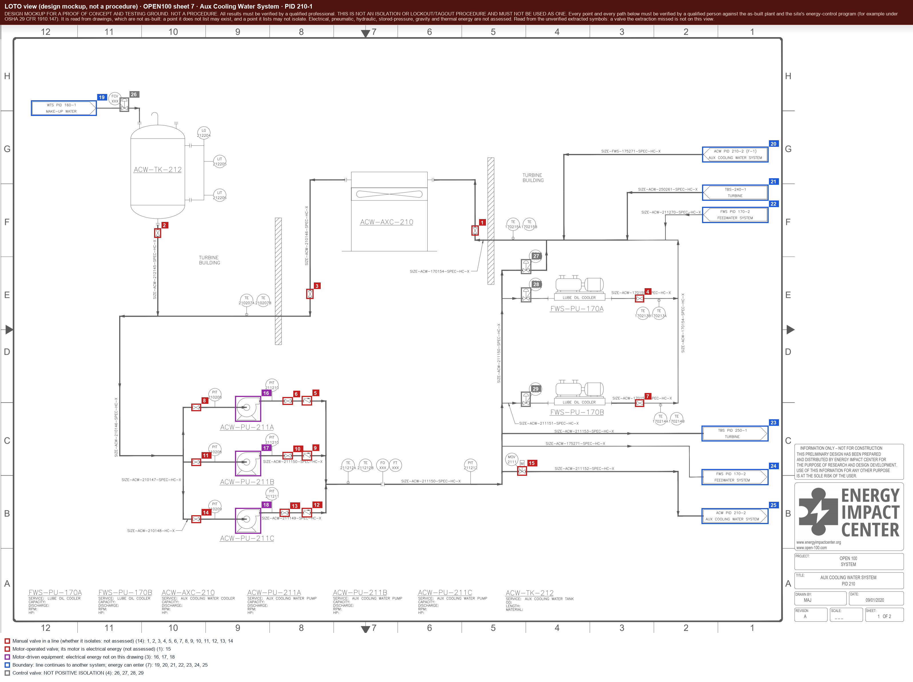

# What you can do with only drawings, only process knowledge, or both

**Case-study comparison.** TE and OPEN100 show how different source records support different parts of a twin.
Reuse the modeling, review, graph and export tools on your own inputs; use these assembled examples to plan the
additional context, data and platform work. [Supported workflows](WORKFLOWS.md) gives the reusable contracts,
and [project status](STATUS.md) separates implemented tools from remaining adaptation and validation.

The labels describe what was built **in each case**, not a limit on what your plant can build with more evidence
and engineering work. “Needs additional case inputs” names missing records or process data; it is not a blanket
claim that a capability is impossible. Each note retains the actual evidence and remaining qualification.

*Generated by `scripts/deliverables_matrix.py` from [deliverables_matrix.json](deliverables_matrix.json); edit the
JSON, then run `python scripts/deliverables_matrix.py --write`.*

The two cases start from different halves of the picture. **TE** has process knowledge (a model checked against
the simulator source, and recorded simulator replay) and no original drawing. **OPEN100** has 12 real drawings
and no process data. Drawings supply structural evidence: equipment, connections, flow arrows, off-page links
and isolation symbols. Values, normal behavior, alarm definitions and replay add their own process-data needs.
The OPEN100 case's drawing-derived assembly is described in [OPEN100_STRUCTURAL.md](OPEN100_STRUCTURAL.md):
flow direction read from arrowheads, flags and pump ports (361 of 1,133 process links; the rest stay undirected),
the 12 sheets stitched into one plant, an ISA-101-style mimic, a 3D orientation tour and a LOTO isolation view on
the real drawing (a mockup, not a procedure: a valve the extraction missed is not on the list).

<!-- deliverables-matrix:start -->
| Deliverable | TE: process knowledge, no original drawing | OPEN100: drawings, no process data |
|---|---|---|
| Asset model (equipment, instruments, connections, hierarchy) | **Built in this case**: transcribed from the published process; every tag checked against the simulator source (36 confirmed, 1 corrected) and every unit, stream, direction and tag owner against its balances and flow lines (51 confirmed, 4 corrected, 1 unresolvable of 56); 0 items reviewed by operations ([te_topology_check.md](../out/te_topology_check.md), [te_source_check.md](../out/te_source_check.md)) | **Built in this case**: extracted from the drawings: 2,886 items, all unverified until reviewed, risk tiers 1,811 green / 698 amber / 377 red (22 instruments held at amber by the safety floor); on six held-out drawings (which also chose the method) symbols found F1 0.93, connections 0.87, review load 20.1 per 100, all means of five round-5 runs (the earlier single round-2 run scored 17.8) ([review_queue.csv](../out/twin/r2-tiles-trace/codex/review_queue.csv), [replicates_r5_holdout-a.md](../out/replicates_r5_holdout-a.md)) |
| Tag text read from drawings | **Built in this case**: a round trip on the generated sheets: every tag read on clean sheets by both models, 14% (GPT) and 49% (Claude) at the worst scan level; an upper bound for clean house-style drawings, not real-plant accuracy ([roundtrip_scores.md](../out/te_pid/roundtrip_scores.md)) | **Needs additional case inputs**: the public answer keys carry no text, so tag reading cannot be scored here; on three DEXPI example sheets with labelled symbols (round 5) GPT read 29 of 33 tags exactly and Claude 28, and on two more both found 99-100% of 145 identifiers from the published tag lists |
| Ignition tags and PI AF asset structure | **Built in this case**: loaded into a lab gateway; the PI Builder sheet (schema v2) is checked offline against the vendor-published conventions, not imported into a PI System ([te_tags.json](../out/ignition/te_tags.json), [pi](../out/pi)) | **Built in this case**: same; instrument tags are placeholders until an I/O list maps them, and placeholder PI rows are left unselected ([tags.json](../out/twin/r2-tiles-trace/codex/ignition/tags.json), [pi](../out/twin/r2-tiles-trace/codex/pi)) |
| Original drawing on screen with each instrument's value | **Not yet built in this case**: no original TE drawing exists; a P&ID is now generated from the model in the OPEN100 style (three sheets, not a drawing of record), but it is not a screen background yet ([101.png](../data/te_pid/101.png), [style_fidelity.md](../out/te_pid/style_fidelity.md)) | **Built in this case**: 12 drawing screens, checked in a lab gateway; every unmapped value reads 'not connected' ([native-sheet0-not-connected.png](../docs/screenshots/native-sheet0-not-connected.png)) |
| Flow direction on connections | **Built in this case**: every stream's direction checked against the simulator's pressure-driven flow lines ([te_topology_check.md](../out/te_topology_check.md), [te_process_model.json](../data/te_process_model.json)) | **Partial in this case**: read from drawing evidence (arrowheads, off-page flags, pump ports) on 361 of 1,133 process links; the rest stay undirected and show no arrow ([flow_direction.json](../out/open100_structural/flow_direction.json), [flow-evidence-sheet5.png](../docs/screenshots/open100/flow-evidence-sheet5.png)) |
| Sheets stitched into one plant | **Not applicable to this case**: one process description, no sheets | **Built offline in this case (not in a gateway)**: off-page connectors join the 12 sheets; 38 sheet-to-sheet connections, 36 with a direction ([plant_structure.json](../out/open100_structural/plant_structure.json)) |
| Process mimic overview (ISA-101 style) | **Built in this case**: native acceptance in a lab gateway, plus a 390 px overview at /m; proof of concept: layout and key values are first-pass, not reviewed by operations ([native-revD-overview-normal.png](../docs/screenshots/native-revD-overview-normal.png), [native-narrow-m-normal.png](../docs/screenshots/native-narrow-m-normal.png)) | **Built offline in this case (not in a gateway)**: plant overview and 12 area views from the same screen components; offline render; proof of concept, structure only ([mimic-plant-overview.png](../docs/screenshots/open100/mimic-plant-overview.png), [mimic-area-sheet7.png](../docs/screenshots/open100/mimic-area-sheet7.png)) |
| Equipment purpose cards | **Built in this case**: one sentence per unit, each citing the simulator lines it restates, shown on the 3D tour's stop cards; not reviewed by an operator ([te_unit_purposes.json](../data/te_unit_purposes.json), [02_r-101_normal.jpg](../drafts/3d-tour/02_r-101_normal.jpg)) | **Built offline in this case (not in a gateway)**: from the drawings' own equipment schedules and labels (transcribed, unverified); generic class text where the drawing says nothing, marked as such ([open100_equipment_schedule.json](../data/open100_equipment_schedule.json)) |
| 3D orientation tour (stills) | **Draft for this case**: proof of concept: placeholder geometry, source-checked topology, colours from recorded replay; no render check fails on twelve stills (15 pass, 2 informational), eight review JPEGs committed ([00_overview_normal.jpg](../drafts/3d-tour/00_overview_normal.jpg), [verification.md](../drafts/3d-tour/verification.md)) | **Draft for this case**: proof of concept: placeholder geometry at drawing positions, stops in inferred flow order, structure only ([3d-00_overview.jpg](../docs/screenshots/open100/3d-00_overview.jpg), [3d-01_stop_sheet3.jpg](../docs/screenshots/open100/3d-01_stop_sheet3.jpg)) |
| Lockout/tagout isolation view | **Case-study mockup**: energy boundaries inferred from the seed model (where energy can enter; which device isolates each is not assessed; the purge's boundary sits at the separator); not a procedure ([40_loto_mockup.jpg](../drafts/3d-tour/40_loto_mockup.jpg)) | **Case-study mockup**: boundaries and devices from the extracted symbols, on the real drawing, with sheet and box for each; observations only (control and relief valves marked not positive isolation; which device isolates is not assessed); not a procedure ([loto-isolation-sheet7.png](../docs/screenshots/open100/loto-isolation-sheet7.png), [loto_isolation_points.csv](../out/open100_structural/loto_isolation_points.csv)) |
| Values on the screens | **Built in this case**: recorded simulator replay (proof of concept: not a live plant, and not a simulator that responds to control) ([native-revD-overview-normal.png](../docs/screenshots/native-revD-overview-normal.png)) | **Needs additional case inputs**: needs process data: an I/O list or historian mapping for these instruments |
| Point mapping to data addresses | **Built in this case**: replay channels mapped in the lab gateway ([build_meta.json](../out/ignition/gateway/build_meta.json)) | **Synthetic case demonstration**: a synthetic I/O list shaped like a real export; no real addresses exist for these drawings ([io_lists](../data/io_lists)) |
| Normal bands and early warning | **Built in this case**: learned on half the normal run; on all 21 published faults the bands flag 17 (median 48 min after onset) with 0 false alarms in 193 h of held-out normal running, and miss faults 3, 9, 15 and 19 ([fault_detection.md](../out/fault_detection/fault_detection.md), [normal_bands.md](../out/ignition/normal_bands.md)) | **Needs additional case inputs**: needs a historian record of normal operation |
| Alarms | **Built in this case**: published setpoints, plus a data-source-lost diagnostic alarm per data source; in the lab gateway the pressure alarm fires on the recorded fault, the diagnostic fires and clears, and the header count matches the alarm table ([IGNITION_ACCEPTANCE.md](../docs/IGNITION_ACCEPTANCE.md), [native-current-20261013-alarms.json](../out/ignition/gateway/receipts/native-current-20261013-alarms.json)) | **Needs additional case inputs**: needs setpoints and process data; the drawings name some alarm points but give no setpoints |
| Fault replay and live process tour | **Built in this case**: recorded fault-6 replay; proof of concept: replay is not a simulator that responds to control ([native-revD-overview-fault-alarm.png](../docs/screenshots/native-revD-overview-fault-alarm.png)) | **Needs additional case inputs**: needs recorded process data |
| Operations review | **Not yet built in this case**: tooling built; needs someone who knows the process ([REVIEW_LOOP.md](../docs/REVIEW_LOOP.md)) | **Not yet built in this case**: same; the review queue is ready ([review_queue.csv](../out/twin/r2-tiles-trace/codex/review_queue.csv)) |
<!-- deliverables-matrix:end -->

| OPEN100 plant overview (offline render) | 3D tour stop, structure only | LOTO isolation view on the real drawing (mockup) |
|---|---|---|
|  |  |  |
