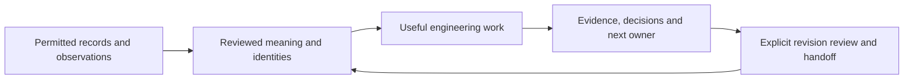

# See engineering information become reusable

For your first company assignment, use the [organization starting guide](ORGANIZATION_START.md) to distinguish
ready-to-run steps, document preparation and human decisions before choosing an episode.
For a first result without installation, start with the [source-question example](../examples/first-pilot/README.md):
read a complete qualified note and substitute your permitted records. The five episodes below are continuations,
not a required sequence or a list of systems to install.

Start with records your company already has. Build a reviewable interpretation, use it for a specific job,
and leave enough evidence and ownership for the next engineer to continue. The goal is engineering knowledge
that supports drawings, investigations, analysis and learning as the plant and its people change.

These five episodes demonstrate different parts of that practice. They reuse the toolkit's existing tools and
worked examples. **They use separate public or fictional fixtures, not one integrated or accepted plant system.**
Choose the episode that matches your assignment; installing a graph or MCP server is not a prerequisite.

## Choose an episode

| Episode and practical question | What to inspect | What you supply at your plant |
|---|---|---|
| **1. Make existing records usable.** What equipment and relationships do our records support? | Choose [a P&ID image](../examples/own-drawing/README.md), [a written description](../examples/from-description/README.md) or [supported DEXPI XML](../examples/from-dexpi-xml/README.md). Inspect source locations, the draft model, review material and supported outputs. | Permitted source revisions; a supported extraction or authored interpretation where required; engineering review and corrections. Image/description interpretation and detailed geometry are not fully automatic. |
| **2. Follow a change beyond the drawing.** What needs another look when the arrangement changes? | [One pump to proposed duty/standby](../examples/engineering-change/README.md): changed model and drawing, regenerated equipment staging, changed generated-question scope and a retained answer reopened by explicit refresh. | Your change basis, reviewed model/layout and identities, applicable departmental records and authorized receiving process. A proposed arrangement does not prove installation or operability. |
| **3. Connect observations to a decision.** What does the recorded process data actually support? | [Phase calculations](../examples/batch-analysis/README.md): feed/energy totals, quality and interpolation choices, [one measured laboratory source](../examples/batch-analysis/public-distillation/README.md), then [retained findings and missing evidence](../examples/batch-analysis/context-handoff/README.md). | Qualified asset/signal identity, units, timing, phase and quality semantics; recipe/lab/model evidence only where the question needs it. Calculation is distinct from yield, diagnosis or prediction. |
| **4. Help a newcomer contribute.** Can the next engineer find the basis and return a useful result? | [First-question assignment](../examples/first-pilot/README.md) and [worked knowledge-only note](../examples/engineering-onboarding/own-packet/worked-note.md). A leader assigns a bounded job, sources, reviewer and destination; the contribution retains unknowns and next actions. | Approved records and client, an actual mentor/reviewer and company record location. Manual or approved-Copilot review works without local installation. Human benefit is an acceptance question, not a measured result here. |
| **5. Keep ownership as teams join.** Who must revisit an answer when another team revises its basis? | [Four owned packets](../examples/team-context/README.md): selected Process/E&I/Maintenance dependencies, a separate site, retained disputes and a receiving brief. | Site-qualified identity mappings, actual owners, publication/receipt rules, access and review responsibilities. The tiny fictional workload does not establish enterprise capacity or complete physical impact analysis. |

The exact accepted files and output connections belong in [WORKFLOWS.md](WORKFLOWS.md). The
[feature reference](FEATURES.md) links implementation evidence; [results](RESULTS.md) explain measured research.
An authored tutorial demonstrates a workflow, not unfamiliar-model accuracy or a guarantee for your records.

## What each piece contributes

The model carries shared equipment identities and represented relationships. Generation tools use supported
parts of that model to create draft views and staging files. The question engine screens represented evidence
for particular investigations; authored follow-ups can capture a different job without pretending the catalog
discovered it. Analysis tools combine selected observations with explicit calculation assumptions. The context
register keeps answers, their source dependencies and the decisions and roles supplied with them.

The [read-only MCP starter](../examples/internal-mcp/README.md) is an optional way for an approved client to read
selected snapshots. It does not automatically search every company document, refresh analyses, authenticate
employees, or grant access across an IT/OT boundary. MCP is an access option; the maintained knowledge and its
review responsibilities are what make the information useful to a person or assistant.

Together these are foundations for a maintained digital twin and shared engineering knowledge. Structural
models answer what is represented and connected; qualified observations add behavior; suitable validated models
can support prediction when required. Each step needs evidence for its intended use. More files or a richer
graph alone do not establish a better decision.

## Demonstrate a result, then its next revision

For a walkthrough, show the starting record, the work product and the review question first. Then show what
actually changes when the source, model or calculation basis changes. Keep the earlier version visible. End with
the unresolved evidence and the next owner, so the viewer can distinguish a generated draft from an accepted
company record. Use the supplied refusal controls to test a wrong or stale input, rather than relying on a clean
happy-path screenshot.

The [Entellia/Flow2MTP review](COMPETITIVE_WORKFLOWS.md) reinforces the value of showing one unit through
successive engineering steps. Within an episode, keep its asset IDs, input/output revisions and review
decisions visible. If the job extends to automation, separate requested behavior, supplier response and
receiving evidence with the [manual worksheet](../examples/consulting-start/AUTOMATION_HANDOFF.md).
The five separate fixtures above remain separate; no integrated automation or MTP workflow is implied.

For your own trial, record one observable benefit and baseline before running it: whether a recipient can find
the cited basis, spot a planted stale answer, or complete an agreed review with acceptable errors and effort.
Use the [acceptance exercise](ACCEPTANCE.md) with real people. Runtime assertions and agent review cannot
substitute for that trial. Keep company material in approved private locations; the public fixtures are examples
of what to substitute, not records to copy into your plant model.

## From one assignment to a supported company capability

| Where it is used | What makes the approach robust | Signal to change the implementation |
|---|---|---|
| One engineer or small team | Bounded job, retained sources, named reviewer and backup, explicit refresh and receiving check. | Work survives poorly when the author leaves, or recurring manual checks have no supported owner. |
| A whole site with several departments | Owned publications, reviewed identities, declared dependencies, controlled acceptance and recovery. | Teams depend on shared context but cannot reliably deliver revisions, resolve conflicts or withdraw access. |
| Many sites or a global organization | Site-qualified scope, local applicability review, supported access/audit/release operations and tested service behavior. | Cross-site reuse depends on unsupported scripts, ambiguous tag matches or a central team manually reconciling every exception. |

The [foundation roadmap](ENGINEERING_FOUNDATION.md) explains what each capability unlocks; the
[scaling guide](SCALING_ENGINEERING_CONTEXT.md) gives failure signals and receiving trials. A managed product
or supported incumbent company service becomes appropriate when others rely on this context staying current,
permission-correct and traceable, and the existing arrangement cannot sustainably provide that. Existing
engineering, document and operations systems can retain authority for their own records.

Choose the deployment path from the [IT/OT connectivity guide](INTERNAL_CONNECTIVITY.md): manual/approved
Copilot, local tools, approved exported snapshots, or a separately authorized integration. Disconnected and
no-port plants can still use the recorded-data and document workflows. The demos require no cloud processing
of company data and do not establish a tested company Copilot deployment.
