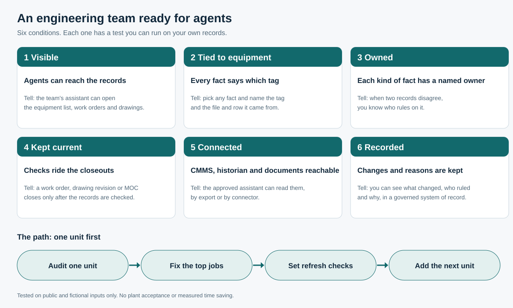

# The end picture: an engineering team ready for agents

More of a plant's engineering work will be done with assistants that read your records and draft the first
answer. An assistant is only as good as what it can reach. It needs the correct data, in a usable format,
refreshed at the right interval, connected to the people who own it, with a record of what changed and why.

## Six conditions

| Condition | What it means | You can tell because | See it worked |
|---|---|---|---|
| **1. Visible** | Agents can reach the records. | The team's approved assistant can open the equipment list, work orders, datasheets and drawings without someone emailing a file. | [Document questions](DOCUMENT_TEXT.md), [first question](../examples/first-pilot/README.md) |
| **2. Tied to equipment** | Every fact says which tag it belongs to. | Pick any fact. You can name its tag and the file and row it came from. | [Maintenance intake](MAINTENANCE_INTAKE.md), [replacement handoff](../examples/maintenance-handoff/README.md) |
| **3. Owned** | Each kind of fact has a named owner. Disagreements go to that owner. | When the equipment list and a datasheet disagree, you know whose queue the question lands in. | [One map](ONE_MAP.md), [two-plant example](../examples/one-map/README.md) |
| **4. Kept current** | Checks ride closeouts: the work order, the drawing revision, the MOC. Each record has a refresh interval. | A work order cannot close with the datasheet still showing the old valve size, and every record has a "refresh by" date. | [Running the map](RUNNING_THE_MAP.md), [MOC on the map](../examples/one-map/README.md#the-pasteurizer-through-an-moc-pid-revision-moc-open-and-close-work-order-walkdown) |
| **5. Connected** | CMMS, historian and documents are reachable by the team's approved assistant, by export or by connector. | A question that spans a work order, a trend and a datasheet gets one answer with all three cited. | [Connectivity paths](INTERNAL_CONNECTIVITY.md), [historian CSV](../examples/historian-csv/README.md), [PI mapping](PI_MAPPING.md) |
| **6. Recorded** | Changes and the reasons behind them live in a governed system of record. | Six months from now, you can see what changed on a unit, who ruled on it and why. | [Context lifecycle](CONTEXT_LIFECYCLE.md), [foundation handoff](FOUNDATION_HANDOFF.md) |

Each condition raises what an assistant can safely do with your records, from finding documents to working
inside a governed service that keeps the records current. The
[self-assessment](READINESS_AUDIT.md#what-your-records-can-support) maps the conditions to four tiers of
assistant work.

## Where most plants start

Records sit in a CMMS export, a shared drive, a drawing vault and people's heads. Tags are spelled three ways.
Nobody is sure which datasheet is current. Updates happen when someone remembers. An assistant pointed at that
pile returns confident answers that nobody can trace.

That is normal. It is also fixable one unit at a time.

## The path: one unit first

1. **Assess one unit.** Find where it stands on each condition. See the
   [readiness self-assessment](READINESS_AUDIT.md) and a [worked sample](../examples/readiness-audit/SAMPLE_REPORT.md).
2. **Fix the top jobs.** Reconcile the records that disagree, recover missing drawings, check returned
   revisions. The [job table](../README.md#start-wherever-you-are) routes each job to a worked example.
3. **Set refresh checks.** Attach record checks to the closeouts the plant already runs.
4. **Add the next unit.** Reuse the owners, the formats and the checks.

Later, when shared records need managed upkeep, access control and history, hand them to a governed system of
record. The [foundation roadmap](ENGINEERING_FOUNDATION.md) covers that step.

## Limits

This repository is tested on public and fictional inputs only. No plant has accepted it and no time saving has
been measured. Everything it produces is a draft for engineering review. Your company systems keep authority
over approvals, access and continuing ownership.
