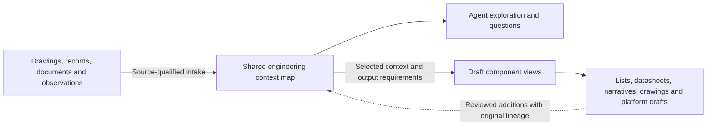

# What the engineering foundations unlock

## This toolkit's focus: build and use the engineering context map

Help engineers and engineering managers connect their records into a sourced map,
then use it to answer engineering questions. Equipment, instruments, drawings,
documents, observations and their relationships are the substance of that map.
Keep identity, source revision, uncertainty and disagreement visible when answering:

- What do we know about this equipment, and where does each fact come from?
- Which drawings, documents and connected items concern it?
- Where do records disagree, or leave a relationship unverified?
- What changed in a returned drawing or source revision, and which answers need rechecking?

Use the existing [one-map tools](ONE_MAP.md), [qualified drawing-path questions](PID_GRAPH_QUESTIONS.md)
and [context register](CONTEXT_REGISTER.md) for their documented inputs and questions.
The [offline map explorer](../examples/map-explorer/README.md) makes built maps,
sources, questions and previous/current snapshots available to people and agents.
An engineer or their agent should be able to follow the answer back to its evidence,
see the limits, and retain a reviewed contribution to the map.

Work-order history and consultant returns can supply engineering evidence. Reading
those records does not make job preparation or work management the toolkit's next
layer. Job-readiness gates, work assignment, reminders, approval workflows and
execution tracking belong in the responsible company systems or a managed product.
Review states here describe the evidence and interpretation; they do not release work.

Further development should deepen map construction, navigation, sourced questions
and revision comparison, then use that shared context to draft its component records.
Portable exports and bounded receiving checks support later adoption by ChangePilot
or another tool without making the toolkit an operated context-management service.

## From the records you have to a maintained foundation

Start with one useful question. You do not need to buy a product, finish a plant
graph or enter the same facts into several templates before getting an answer.

| Step | Engineer or agent does | Value and retained work |
|---|---|---|
| Bring a small permitted sample | Inspect existing exports, documents or the original/marked-up/returned drawing set. Confirm only identities, meanings and access that affect the question. | A useful first finding with original source locations, disagreements and missing evidence. No signup required. |
| Keep the basis | Retain scoped identities, exact permitted originals, source revisions, mappings and supplied interpretations in the supported packet. | The next question starts from existing context. Preparation and engineering review remain visible work; an agent does not infer authority from a matching tag. |
| Use and revise it | Query facts and relationships, inspect sources, derive supported component drafts, retain editorial proposals and bring the next source revision. | Reuse facts across outputs and identify what changed. Drafts stay traceable to their basis; copies do not become additional corroboration. |
| Transfer a declared scope | Check the receiving product's installed contract, permissions and limits; deliver the retained packet through its supported import. Have the recipient read back the original facts, conflicts, sources and history. | Carry the prepared context forward without typing its retained facts again. Unsupported fields, preparation and receiving steps must be disclosed before relying on the transfer. |
| Maintain it in an agreed home | Name authoritative source homes, accepted-fact owners and the refresh/support responsibility. Exercise another revision, loss of access, retry/recovery and complete export. | A maintained service becomes valuable when shared reliance outgrows the team's current arrangements. The company still owns engineering acceptance and its master records. |

The [task-first guide](AGENT_START_HERE.md) owns choosing and completing the first
job; the [component exercise](../examples/map-component-cycle/README.md) owns the
bounded common-basis commands. Do not ask a customer to rewrite JSON or re-enter
facts already retained in a supported input. Ask for a genuine identity, source
meaning or permission decision when it changes the result, and retain that answer
for the next revision. Count source interpretation, mappings, setup, retries and
review when assessing friction; zero JSON editing alone does not prove low effort.

**ChangePilot receiving is being qualified, not offered here as a released
integration.** The active [acceptance plan](../examples/map-component-cycle/PLAN.md)
requires real product persistence, private human/agent readback, revision and
conflict handling, interrupted/repeated delivery, access withdrawal and complete
export/reopen. Toolkit packet verification cannot substitute for those checks.
Keep using the offline foundation while the receiving contract is unfinished;
do not repeat preparation just to demonstrate a product. A managed service's
value must be continuing access, accountable maintenance, history and recovery
for the agreed scope, demonstrated in that service, rather than another copy of
the same documents. Existing company tooling may already meet that need.

### What makes a customer ready to transfer

Readiness applies to an agreed **context scope**, not a complete plant graph.
A manager can start with two exports and one unresolved question. They do not
need a P&ID, CAD session, historian connection or completed datasheets to use
that evidence. Missing records remain questions to answer later.

Before transferring, show the customer a short receiving brief:

| Explain | Concrete receiving check |
|---|---|
| The useful result | Ask the same engineering question before and after import. Compare the actual values, original source locations, disagreement and uncertainty; a successful upload is insufficient. |
| The included scope | Name the site/unit/items, history and exact original files. Inspect complete included files for other-unit or confidential content; selecting graph rows does not redact their original files. |
| The remaining work | List unknown identity, source authority, interpretation and unsupported formats. Preserve them rather than making the customer complete every field before first use. |
| The continuing owner | Identify where released drawings, CMMS records and accepted engineering facts belong, who refreshes this context and how the next source revision enters it. |
| The exit path | Export the declared scope from the receiving service and reopen it independently, including its original evidence and retained history. |

For the customer, the desired interaction is to review that brief, sign in through
the receiving service's normal flow, select the prepared package and inspect the
same finding. An agent can prepare the package and reuse retained mappings;
the customer should not rebuild a graph or type its facts into another set of
forms. Clarifications about identity, permission and engineering meaning remain
real decisions. Installation, extraction, review, navigation and recovery effort
still count when assessing friction.

ChangePilot earns the next step when a team needs continuing authorized access,
reliable revisions, retained decisions and recovery around that shared context.
Agree and demonstrate those responsibilities for the selected scope. SharePoint
can remain the authoritative document home, and an existing Copilot can keep
using it. A receiving context query adds exact retained item/fact/history access;
MCP is an optional interface and does not inherit document permissions or replace
engineering review. The qualification plan above must pass before describing
this intended customer interaction as a released ChangePilot capability.

## One engineering model, many draft components

**Intended architecture:** the map is the reusable engineering context behind the
hub and spokes. Agents should be able to explore and query it, then request a
rough component from the context already present: an equipment or instrument
list, datasheet scaffold, loop sheet, process description, drawing or platform
draft. Related documents contribute overlapping facts and structure, so producing
the next document does not restart the engineering description from scratch.

This is a development direction, not a claim that today's graph can generate
every component. The [current contracts](WORKFLOWS.md) still include separate
generator models and authored drawing layouts. The existing context-map format
[design](CONTEXT_MAP_FORMAT.md#how-todays-toolkit-formats-fit-in) already proposes
making those models views of the map; that reverse path remains unimplemented.
The [bounded common-basis prototype](../examples/map-component-cycle/README.md)
now reuses ordinary record exports for three draft components with retained edits
and revision impact. Its offline review lets an engineer inspect component fields
and download a basis-bound proposed text edit without writing JSON. This does not yet project existing one-map exports into the
generator model. Its bounded `generate` route projects supported source-declared
equipment from the common basis into the existing generator, with readable SVG
and equipment-only platform scaffolds; it infers no piping, controls or live
signal mappings. Complete managed-product qualification remains unfinished.

The minimum context is **specific to the requested output**, not a single
"map complete" flag. A partially populated map can already be useful. Return a
partial draft or outline with gaps when that is all the selected context supports.
Do not make the user reconstruct facts separately for each generator.

| Requested draft | Context that can scaffold it | What remains explicit when absent |
|---|---|---|
| Equipment/instrument list | Scoped identities, kinds/classes, descriptions and known properties | Missing classifications and properties; position and physical-item identities remain distinct |
| Datasheet | Item identity/class, applicable sourced properties, units and service context where available | Blank requirements/unknown values, conflicting alternatives and missing applicability evidence |
| Loop sheet or control-narrative outline | Instrument roles, measurement/controller/final-element relationships and any supplied behavior | Missing loop members, signal details, setpoints, sequences and fail behavior; connections alone do not establish a control strategy |
| Rough process schematic or P&ID draft | Equipment and appropriately typed connection/placement evidence | Unknown paths/media/direction; generated layout is presentation, not recovered CAD geometry. Network membership is not physical adjacency |
| Draft asset hierarchy, HMI/tag or PI staging | Scoped assets, instrument variables/units and supplied relationships/mappings | Missing addresses, signal identity, presentation details and receiving-specific configuration; no live acceptance |

These examples describe output requirements, not a second feature catalog or a
promise that every adapter exists. An extensible component adapter should declare
its required and optional context and reuse the existing generators where they fit.

### Agent interaction and generation contract

1. **Discover and query.** Expose the available entity/relation/property types and
   supported draft targets. Permit scoped lookup, typed filtering, relationship
   traversal and retrieval of full claims and their evidence. An agent should be
   able to ask which facts disagree or which target lacks context without loading
   every unrelated document. Begin with local functions/CLI and versioned JSON;
   MCP is an optional interface, not a prerequisite or an authority service.
2. **Check the requested component's context.** State which supplied facts support
   the draft, which requirements are unknown or conflicting, and whether the
   result can be a partial draft or only an outline. This checks an artifact's
   inputs; it does not decide whether maintenance work is ready or authorized.
3. **Generate a view with a basis.** Retain the map snapshot, selected identities,
   source revisions/locators, field mappings, assumptions and adapter/template
   version. Keep sourced facts, derived calculations, interpretation and generated
   presentation distinct. Reuse facts across components through that shared basis.
4. **Return a draft and its gaps.** Give the engineer a readable artifact and the
   machine-readable basis needed to reproduce it. Preserve disagreements rather
   than selecting an unrecorded winner. A changed source identifies dependent
   drafts to revisit; it does not silently release their replacements.
5. **Bring reviewed contributions back carefully.** Link corrections and newly
   established facts to their evidence, preserving previous versions. Generated
   text/layout does not become a new plant observation merely by being imported.
   Company systems and responsible engineers keep release and ongoing service roles.

### Redundancy should add context without manufacturing corroboration

An equipment list, datasheet and P&ID can supply complementary pieces for the same
item. Agreement may help cross-check a fact; disagreement can identify an error
or a difference between design, installed and operating context. Retain those
roles, applicability, dates and sources rather than merging every equal tag/value.

**Three documents copied from one source are one evidence lineage, not three
independent confirmations.** A draft generated from the map must retain its roots
if it comes back as an input. Otherwise a mistaken value could be copied around
the wheel and appear better supported each time. Generated drafts can provide
structure and reviewed proposals; independent evidence requires an actual new
source or observation, not another rendering of the same claim.

### Human-editable components and retained corrections

The [Claude-to-CAD source review](COMPETITIVE_WORKFLOWS.md#moshe-baum-keep-generated-components-useful-for-the-engineer-who-edits-them)
adds acceptance requirements to component generation:

- **Name the editing target.** A draft needs a retained working source and useful
  editing structure for its purpose: document fields, graph identities and
  relationships, drawing entities, or parameters/features where claimed. Keep
  the field-to-map mapping. A flattened preview alone does not establish editability.
- **Exercise takeover and regeneration.** Make one declared manual correction,
  reopen/read it back and retain unrelated fields. On regeneration, compare that
  edited draft with its original basis and the new map. Preserve or explicitly
  report the manual change; do not silently erase it. Return proposed engineering
  changes through the map's existing review route rather than treating every
  edited/generated document as new independent evidence.
- **Load relevant corrections before generating.** Keep compact, versioned,
  source-linked correction records with their affected class/operation, rationale,
  applicability limits and a reproducible counterexample. An agent must retrieve
  the applicable records with the selected context. A session transcript alone
  is insufficient, and repeated exposure is not a claim of model training.
- **Separate constraints from generation.** Check the supplied specification for
  contradictory identities, units, relationships and requirements before building.
  Prefer bounded structured operations where supported. Then measure the actual
  returned artifact under fixed checks with wrong controls; a builder's account
  of what it produced is not the result. Qualify any native or visual behavior
  that those checks cannot establish.
- **Count the engineer's complete task.** Retain preparation, retries, review,
  manual correction and receiving effort beside the ordinary method. A faster
  generator is useful only if the combined job benefits. That human comparison
  has not been measured here.

These are requirements for the planned component adapters, not implemented
cross-session memory, new native CAD capabilities or a managed action service.

### The next implementation depth

Deepen the agent query surface and qualify the bounded **common-basis-to-generator
projection**, then exercise several components from the same selected context.
Before widening targets, retain a matched case showing that a fact is sourced
consistently across drafts, an omitted fact stays unknown, a disputed fact stays
disputed, and a source revision identifies the affected output fields while
unrelated context remains unchanged. Include a generated-document reimport
control that cannot inflate independent support. The equipment-only record-basis
bridge is a first implemented path; a general projection from existing explorer
maps into every generator contract remains unfinished.

The [active implementation goal](../examples/map-component-cycle/PLAN.md) defines
the customer path from ordinary records to a useful finding, shared context,
component drafts and actual ChangePilot receiving. Its
[required acceptance cases](../examples/map-component-cycle/ACCEPTANCE.json)
remain incomplete. Focused development checks are narrower than those full
criteria and do not establish released product compatibility.

## The broader foundation and its owners

The goal is an organization that can explain its decisions, coordinate work and learn from results. Engineers
should inherit the evidence and reasoning behind a plant or project, make a useful reviewed contribution, and
leave it in a maintained company record. A chatbot, graph or internal endpoint is one part of that capability.

This repository is an on-ramp to that maintained foundation. A maintenance
investigation, drawing review or record cleanup should solve today's job while
leaving evidence and structure the organization can reuse. When continued
reliance needs managed maintenance, auditability and single-source-of-truth
controls, the foundation should carry into **ChangePilot or another suitable
company tool**. Tool selection can follow the work and the operating need.

Here **single source of truth (SSOT)** means explicit authoritative homes and
owners for records and accepted facts, with derived views traceable to the
applicable versions. The CMMS may own work-order status, document control the
released drawing, and a reviewed context record the sourced interpretation and
decision. Define how these fit together, who resolves disagreement, and which
accepted version people may rely on.

From the first job, retain a handoff basis:

- Scope, asset identities and reviewed source-system crosswalks.
- Original evidence or permitted references, revisions, locators and provenance.
- Findings, accepted interpretations, unresolved conflicts and review/decision history.
- Authoritative record locations, accountable owners and receiving responsibilities.
- Dependencies, revision triggers and the agreed refresh/review procedure, including manual steps.
- Portable outputs, destination mappings, known omissions and receiving readback checks.

Record what is actually supplied or unknown in that basis. A named local reviewer
does not establish authenticated approval. A snapshot does not establish an
operated refresh service. The existing [record lifecycle](CONTEXT_LIFECYCLE.md)
owns those distinctions. No released ChangePilot import or live synchronization
is claimed here; qualify the chosen receiving route. Assess improvements by the
useful job completed **and** the reusable, maintainable foundation it leaves.

[Editable SVG](../assets/engineering-foundation.svg) · [Shareable PNG](../assets/engineering-foundation.png)

This is a **capability roadmap, not a mandatory installation sequence or a single-product feature stack**.
Start with approved records, one question and human review. That path can produce value before a graph,
retrieval index or MCP server exists. Ownership, access, provenance, uncertainty and validation apply from the
first pilot and continue through every layer. The layers describe intended capabilities, not measured benefits.

## What each layer unlocks

| Foundation or capability | What becomes possible | Evidence needed before relying on it |
|---|---|---|
| **1. Controlled sources and observations** | Find and reconstruct the basis of an engineering claim. | Retained originals or permitted source snapshots; document IDs/revisions/locators, owners and approved access. Operating observations also need time, quality, units and mode. |
| **2. Shared engineering meaning** | Connect records about the same equipment, process or requirement. | Reviewed identities and aliases, typed relationships, units, site scope and explicit unknowns. A matching tag alone is insufficient; a graph is one representation. |
| **3. Maintained context and decisions** | Preserve why something was believed or changed, who owns it, and what should reopen on revision. | Source-linked claims, decision/ownership history, declared dependencies, company acceptance and a maintained refresh/review route. |
| **4. Authorized access and evidence retrieval** | Give people and approved assistants the relevant, permitted context for a job. | Correct source/version selection, authorization before disclosure, useful evidence locations, explicit missing/conflicting records and tested access withdrawal. |
| **5. Engineer-reviewed workflows** | Reuse onboarding, investigations, calculations and draft-generation methods. | Declared inputs and versions, appropriate validation, review of the result and an authorized receiving process. A draft or completed script is not a company release. |
| **6. Execution evidence and outcome learning** | Compare intent with what was actually done, assess results and improve future decisions. | Authorized execution/configuration records, qualified observations and an effectiveness review. A recommendation or completed-task flag alone does not establish success or causation. |

The arrows back matter. An investigation can expose a source error; propose a correction through its owner.
Reviewed execution and observations become new evidence. Preserve the previous source and decision basis while
the responsible reviewers establish what now applies. Do not silently overwrite a drawing of record to match
a generated model or infer that a shared template was adopted at every site.

## The managed-product handoff line

**Hand over service operations when other people rely on this context staying current, permission-correct and
traceable, and the current company arrangement cannot sustainably provide that.**

For a bounded assignment, a named publisher, reviewer and backup can use these tools with existing company
records and approvals. As the result becomes a continuing dependency for other teams, the obligation changes:
someone must operate access, publication, revision handling, conflicts, recovery and support after the original
author moves on. Avoid quietly turning a collection of personal scripts into that business-critical service.

| Situation | Practical decision |
|---|---|
| One bounded investigation; existing company controls and owners are adequate | Keep the simple tool/manual/approved-Copilot route. Preserve the contribution and review history. |
| Other teams repeatedly depend on the context, and reliable changes/access/review require unsupported manual coordination | Evaluate a managed product or an appropriately supported existing company service before widening reliance. |
| Required access, approved history, revision identity or conflict handling cannot be maintained | Contain the affected path and restore an authorized company review route. Involve the service owner/product architects before relying on it again. |

The company keeps engineering judgment and approval authority. The product takes on a **defined service
responsibility**, demonstrated in a bounded receiving trial. Existing company platforms may already satisfy it;
a new purchase is not a requirement of this roadmap. The [scaling guide](SCALING_ENGINEERING_CONTEXT.md) provides
specific small-team, site and global failure signals and service-evaluation criteria.

The handoff should carry scope and identity mappings, source IDs/revisions/locators, permitted retained evidence,
reviewed facts and uncertainties, decisions and owners, dependencies, access requirements and the proposed
refresh/acceptance route. Have the receiving owner read these back, then exercise a source revision, conflicting
proposal, revoked access, interrupted delivery and complete export. These company trials have not been run here.

## One product does not need to own the whole engineering graph

A process/operations-focused product can maintain the **operations-relevant context and decisions** while
engineering and business systems retain their own responsibilities. For example, an equipment investigation
may depend on selected drawing facts, a vendor limit, a maintenance event and operating observations. Preserve
the permitted, version-bound basis for that decision and its provenance; a live URL alone can lose its meaning
when the target, revision or access changes. That does not require importing every CAD object or design calculation.
A complete P&ID-derived process graph may fit this scope. The boundary is engineering meaning and responsibility,
not an arbitrary node count: maintaining a process model does not require becoming the owner of every engineering system.

| Responsibility | Recommended ownership boundary |
|---|---|
| Released drawings, detailed engineering models, specifications and design calculations | Their engineering/document/PLM owners and systems remain authoritative. Retain reviewed references or declared projections for the operational job. |
| Process/operations interpretations, investigations, decisions and their evidence dependencies | A company-approved process/ops context service can maintain this declared scope, with review, uncertainty, history and source-change handling. |
| Work orders, change releases and execution status | The system assigned authority for each record keeps it. Link actual receiving/execution records rather than inventing a second approval or completion status. |
| Generation and analysis | Tools consume supported, selected inputs and return drafts, checks and receipts to the responsible review route. An adapter must preserve or report unsupported fields. |

Keep as-designed, as-installed and as-operated claims distinct where they differ. Return an engineering change
proposal to its owner rather than letting an operations interpretation rewrite the design master. Expand into
another engineering domain when recurring work justifies it and domain owners can validate the meaning,
permissions, receiving behavior and continuing support. A generic graph alone does not supply that expertise.

## Teach RAG now; defer the infrastructure until there is a job for it

**Retrieval-augmented generation (RAG)** retrieves relevant information and supplies it to a language model as
context for a generated response. A company implementation must select permitted content; users still need to
check whether the source actually supports the answer. Microsoft's
[RAG overview](https://learn.microsoft.com/en-us/azure/search/retrieval-augmented-generation-overview) describes
retrieval, limited model context and access-control concerns. The concept helps a reader understand what an
approved Copilot or future context product is doing without requiring them to build a retrieval platform.

| Term | Job | What it does not establish |
|---|---|---|
| Search or structured lookup | Find relevant text or exact records. | That the record is current, authoritative or sufficient for the decision. |
| Knowledge graph | Represent identities, relationships and sourced claims. | A graph export alone is not an implemented GraphRAG pipeline. |
| RAG | Use retrieved information to help generate an answer or draft. | Source truth, access enforcement, engineering approval or automatic document maintenance. |
| MCP | Connect a client to declared tools/resources. | A retrieval index, company identity service, RAG implementation or permission to cross IT/OT boundaries. |

A simple learning exercise is: select permitted evidence, ask a bounded question, inspect its references,
separate source statements from inference, and return a draft or missing-evidence request to a reviewer.
Preserve the source revision and rationale in the company record. Microsoft's
[grounding guidance](https://learn.microsoft.com/en-us/azure/architecture/ai-ml/guide/rag/rag-prompt-engineering)
explains the role of source metadata, citations and missing/conflicting information; prompt instructions still
need validation and cannot enforce permissions.

Teach that distinction here. Leave embeddings, chunk sizes, index products and retrieval orchestration for an
approved implementation with a real workload. Keyword search, exact queries or selected documents may be enough.
Any future RAG deployment needs separate retrieval/answer evaluations, including source versions, citation
support, access refusal/revocation, insufficient evidence and reviewer effort. No RAG pipeline or RAG evaluation
result is supplied by this toolkit. Introducing the concept does not change that implementation boundary.

## What is available here, and what remains company integration

The [selected-unit foundation cycle](FOUNDATION_HANDOFF.md) now connects supplied
maintenance dossiers and exact single-subject drawing requests to scoped graph
assets, retains the full originals and uses the existing context register and
snapshot reader for actual local receiving. Its separate-process example covers
complete typed readback, source-only changes, conflicting proposals, unavailable
evidence and full export/reopen. Native projections and archive-only information
are reported separately. It is a portable software foundation, not a managed
source-of-truth service or a qualified ChangePilot import.

The toolkit provides local source/model intake, graph exports, question screens, review/history mechanisms and
generation/analysis tools through their [documented contracts](WORKFLOWS.md). The local context register requires
explicit refresh. The [MCP starter](../examples/internal-mcp/README.md) reads selected startup snapshots; its
metadata lookup is not a document-search or RAG backend and it has no company authentication. These mechanisms
teach selected parts of the roadmap, rather than completing every layer or operating a shared company service.

Company acceptance, authenticated publication, maintained connectors and a verified operational outcome loop
remain integration work. Controlled documents, work orders and operating data can stay in their existing systems.
Use approved exports, replicas or local-only work where required; the roadmap requires no new OT network path
or cloud processing. See [connectivity](INTERNAL_CONNECTIVITY.md) for the actual choices and boundaries.

### Explicit scoped portable record packets

The [record workflow](WORKFLOWS.md) distinguishes ordinary draft selection from explicit
`records_scoped_v1` packet projection. Scope preview lists every included whole file and requires its
exact digest as a permission declaration before packaging. Unrelated structured records, source files
and history are omitted; included whole files can still contain unrelated content. No row-redaction,
authentication or company-acceptance claim follows. Typed edges keep their original direction and IDs.
Incoming identity-only subjects are explicitly unexpanded `external_subject_reference` records, excluded
from default draft targets; missing context refuses expansion instead of becoming a known empty entity.

Scoped historical corrections retain the original immutable proposal and full-parent commitment while
replaying only the selected field/source witness. They do not verify an omitted whole parent basis or
authentic origin. New edits require the original permitted whole packet followed by a new explicit preview
and scoped package. Scoped delivery/reopen is a separate local contract; managed receiving must explicitly
support it before acceptance is claimed. Existing whole/full and whole/compact replay semantics remain.

Fully retained supporting records may be explicitly targeted in scoped materialization, while default
targets remain the original selection. Dependency exports use the distinct
`engineering-scoped-component-materialization-1` envelope: the existing component draft, exact supporting
context, and a text appendix within the single delivered JSON. Maintenance records are not relabeled as
assets; unsupported components retain empty items and explicit gaps. Identity-only external references
remain nonselectable. Original whole/default materialization keeps its existing contract.

Scoped identity-crosswalk replay retains whole disclosed bytes while interpreting only retained subjects'
original rows and source declarations. A unique alias inside an explicitly selected projection is not a
global or namespace-wide identity claim. Full-input ambiguity refuses before selection, and inactive alias
evidence remains readable without activating lookup. Omitted subjects' aliases are not imported merely
to preserve a wider lookup context.
