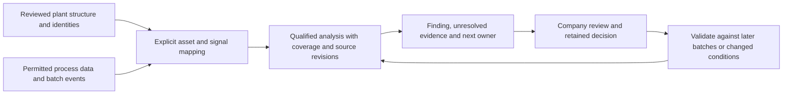

# Use process data with the twin

**Connect the structural twin to reviewed process observations, then choose an analysis that answers an
engineering question.** A P&ID-derived model supplies asset identities and represented connections. Historian
values, batch events, lab results and operating records supply behavior and outcomes. Keeping those together
makes an investigation reusable when another engineer inherits it.

Many useful jobs need no kinetics. Connecting data is also not sufficient for every job: a feed total can be
calculated from a qualified mass-flow signal; predicting growth under a new feed policy needs a defensible
dynamic model. Ask what the decision needs before declaring a missing model or buying another system.

## Choose the smallest useful job

| Question | What to connect | Path today | Extra model needed? |
|---|---|---|---|
| Which recorded tags changed unusually? | Comparable normal/scoring exports and operating context | [Historian bands](../examples/historian-csv/README.md); inspect false flags and misses. | No kinetics. Baseline comparability matters; batch phases are not a daily cycle. |
| How much feed or electricity was recorded during a batch phase? | Reviewed signal identity/units, explicit phase boundaries, quality and sampling semantics | [Batch phase analysis](../examples/batch-analysis/README.md), optionally bound to a selected graph; [explicit quality/interpolation choices](../examples/batch-analysis/semantics/README.md). | No kinetics. V1 uses linear interpolation; V2 requires a per-signal linear or previous-value choice and declared quality basis. |
| What measured change could reduce annual energy/cost/emissions? | Before/after measurements, exposure and site constants | [Impact calculation](IMPACT_ESTIMATE.md). Transfer reviewed results explicitly; no automatic batch-report adapter. | No kinetics for the implemented calculation forms. Comparable duty and measurement uncertainty still matter. |
| Can the supplied batches be compared, and what prevents a conclusion? | Reproduced phase calculations plus explicit batch/event/executed-recipe/lab/outcome records | [Local record joins](../examples/batch-analysis/record-joins/README.md) retain source/availability/quality gaps and check calculations against upstream inputs. | No kinetics. Declared record checks do not establish physical comparability or a historical-access/ML study. |
| Can a colleague reconstruct why an explanation failed after records changed? | Selected join/check evidence, authored hypothesis/plan/result/disposition and all source revisions | [Investigation retention](../examples/batch-analysis/investigation/README.md) composes existing capture and readback; missing evidence stays distinct from an observed difference. | Roles and reasoning are authored, not scientifically validated. No process execution, accepted decision or measured human benefit. |
| Why was yield lower or a phase longer? | Above plus feed lots, calibration, interventions, independent tests and environmental context | Retain a [question brief](../examples/first-pilot/README.md) or [context answer](CONTEXT_REGISTER.md). Qualified summaries can supply evidence. | Causal attribution, general live lab/event ingestion, yield modeling and accepted investigation outcomes are not implemented. |
| What would happen under a different feed, aeration or temperature policy? | Validated dynamic equations or identified model, parameters, initial state, constraints and suitable data | **Proposed:** qualify and connect an external simulator; retain its input/output evidence. | Often kinetics, transfer/heat balances, or an independently validated empirical/hybrid model. Specify the prediction and operating envelope first. |

The last two rows are investigation paths, not new automatic capabilities. Existing tools already provide the
first and third jobs. The new phase calculation fills a distinct gap: explicit recipe-time windows, physical
time integration and missing-duration accounting. It does not replace the anomaly detector or a process simulator.

## What to investigate before asking for more kinetics

For one selected job, write down the target decision and acceptable error, then inspect the evidence:

1. **Identity and meaning:** identify the equipment, transmitter, measured quantity, units, scaling, quality
   encoding and relevant source revisions. A matching tag or existing address is a candidate mapping, not a
   verified installed signal. Keep a dissolved-oxygen percentage distinct from a mass concentration.
2. **Timing and operating scope:** qualify clocks, sampling/deadband/interpolation, batch ID, phase boundaries,
   recipe revision, vessel scale and relevant modes. Do not infer phase from the same signal whose anomaly you
   want to find. Lab sample time and lab result availability answer different questions.
3. **Calculation sufficiency:** for feed mass, obtain mass flow or independently qualified density/concentration
   conversions; for yield, obtain the appropriate consumed-substrate and product basis, including volume changes
   and sampling losses. Missing flow or a missing assay is a data gap, not automatically a kinetics gap.
4. **Prediction sufficiency:** only if the job needs future/alternative behavior, request the existing equations,
   parameter sources, initial-state basis, constraints and validity range. For fermentation these might include
   organism/substrate kinetics, maintenance and inhibition, oxygen transfer and heat removal. What matters depends
   on the question. A fitted model may be unidentifiable even with many historian rows.
5. **Independent challenge:** test an untouched later batch or campaign, compare with a simple baseline, retain
   misses and uncertainty, and have the responsible engineer review the decision. Split by batch/campaign/site
   rather than randomly leaking adjacent samples across training and testing. A model that cannot beat the
   current recipe or simple baseline has not earned an operational role.

The [question engine](OPPORTUNITY_SCREEN.md) already relates supported structural questions to collection
requests and mapped tag candidates. Its current catalog does **not** automatically inspect an arbitrary analysis
plan or determine whether fermentation kinetics are sufficient. Use a plain brief for that job today; keep
the question, missing evidence and owner with the result. A dedicated readiness adapter would need its own
source-backed rules and positive/negative corpus before becoming a toolkit claim.

Use the [worked analysis handoff](../examples/batch-analysis/context-handoff/README.md) and its manual
[readiness worksheet](../examples/batch-analysis/context-handoff/readiness-review-template.csv) to keep these
requests with the finding. It separates event/quality, executed recipe, lab/product and predictive-model needs,
including sample time versus result availability, revision, units, reviewed joins and next roles. These are
authored investigation questions, not new automatic catalog rules. The separate
[record-join tool](../examples/batch-analysis/record-joins/README.md) now checks explicitly supplied normalized
batch/event/recipe/lab/outcome files; it does not discover joins, retrieve live records or infer source meaning.

## How the current pieces connect

Use your [P&ID](../examples/own-drawing/README.md), [description](../examples/from-description/README.md) or
[supported DEXPI](../examples/from-dexpi-xml/README.md) to build and review the structure. The existing
[OPC mapping](REVIEW_LOOP.md) and [PI mapping](PI_MAPPING.md) tools assign supplied addresses through their
documented contracts. They do not fetch live history or qualify units. Export the supported model through
[graph export](GRAPH_EXPORT.md) when an analysis needs stable asset references.

Acquire an approved export or data from an existing approved replica; preserve the original and record any
conversion. Select the analysis and explicit parameters. The batch tool can resolve its supplied equipment and
instrument IDs against a selected `twin-graph-1` snapshot and retain its exact hash. It checks membership and
record status, not the physical mapping, sensor calibration, units in graph attributes or process relationships.
Analysis results stay in a sidecar: no automatic graph updates, context-register answer import or live connector.
Before reusing a saved batch calculation, the [basis checker](../examples/batch-analysis/basis-check/README.md)
compares explicitly selected CSV/plan/graph and current calculation/validator code, then reproduces the complete
result only when those pins match. It does not monitor sources, validate the method independently or refresh context.
An engineer can cite the report as a source in the existing manual context-answer route.

The [worked handoff](../examples/batch-analysis/context-handoff/README.md) demonstrates that route: a fictional
partial proposal is retained, a report-source revision reopens it while preserving history, and the complete
graph/register pair can be read through the existing pure snapshot API. It starts no MCP transport. The reader
does not chase a report's CSV/plan hashes automatically; regenerate and review dependent analyses explicitly.

The [MCP starter](../examples/internal-mcp/README.md) retrieves selected graph/context/knowledge snapshots. It
does not execute analysis or retrieve live signals. Retain reviewed findings through the existing packet path
before making them available to an approved client; merely placing a report beside the graph does not expose it.
Use [connectivity](INTERNAL_CONNECTIVITY.md) for Copilot-only, local, replica and no-port environments. Offline
CSV analysis needs no new OT port. Live read access is possible through a separately approved integration;
plant control is a further engineering and authorization boundary.

## Lessons from Flowstead: accessible calculations with a retained basis

Reviewed 2026-11-08 after [Hazem ElMancy's browser-simulator post](https://www.linkedin.com/posts/hazemmancy_processengineering-chemicalengineering-processsimulation-share-7524462037176074240-LHoB/).
[Flowstead](https://github.com/HazemMancy/Flowstead) uses DWSIM and publishes a browser implementation.
Its [engine-version record](https://github.com/HazemMancy/Flowstead/blob/c2d431f67673c6dc94d4218a81ed60cd5ae9a6c3/ENGINE_VERSION.md)
pins an engine source/version and patches; its
[benchmark guide](https://github.com/HazemMancy/Flowstead/blob/c2d431f67673c6dc94d4218a81ed60cd5ae9a6c3/benchmarks/README.md)
distinguishes engine-generated regression values from separately sourced references. Those are different
forms of evidence. Its browser tests exercise the actual worker path; we inspected that test code, not the
complete test run. The project declares GPL-3.0-or-later. No implementation or case files were copied here.

One [public browser observation](../examples/external-simulator-review/flowstead/README.md) opened the
app without an account and solved its supplied water-saturation case. The selected displayed temperatures
and enthalpy difference match the project's reference tolerances. A pointer-selection failure and
programmatic workaround are retained. The exact live build, phone experience, offline operation, file
exchange, privacy behavior and the rest of the numerical/safety features were not qualified.

Useful lessons for the existing manager workflow:

- **Make the first result easy to inspect.** The toolkit already exports readable offline reports. A future
  browser input/review experiment should start with one job and demonstrate load, review, correction and
  save/reopen at phone and desktop widths. No new browser intake application is implemented by this note.
- **Keep numerical work with an appropriate engine.** An assistant can help prepare a sourced case and
  explain its results. Pin the actual engine, model, parameter basis and calculation settings. Model suitability,
  warnings and independent checks remain engineering work; fluent explanation is not numerical evidence.
- **Retain an editable case beside the report.** Supply original inputs, units/conversions, property model,
  assumptions, engine/version, reference checks and source locators. Exercise open/recompute/readback in
  the named receiving environment. A PDF or diagram alone is not a reproducible simulation.
- **Reopen findings when their assumptions change.** Keep the case and report as explicit sources in the
  existing [context path](CONTEXT_REGISTER.md). A source revision should trigger a review of the calculation's
  basis; no automatic simulator-to-context adapter or dependent-model execution exists here.

Use the [manual calculation worksheet](../examples/consulting-start/CALCULATION_REVIEW.md) to scope an
optional review using a suitable existing simulator. It records baseline/scenario inputs, uncertainty,
references, failure cases, recipient and next revision. This is a potential consulting extension, not an
established service result or permission to treat preliminary safety calculations as accepted designs.

The toolkit's earlier [42 FOSSEE DWSIM flowsheets](GENERALIZATION.md) test structural adaptation and
generation plumbing. They do not execute DWSIM, validate thermodynamics or establish a Flowstead adapter.
Choose and qualify a numerical integration for an actual prediction job; keep maintenance reconciliation
and returned-drawing reviews usable without adding a simulator.

## Lessons from Cassandra and K-log

[Darren Platt's post, published 2026-11-02](https://www.linkedin.com/posts/dplatt_agentic-fermentation-llm-share-7522868844382703617-WIs0/)
describes Pow.Bio's Cassandra/K-log system for mixed-rate and state-based simulation, with a typed language and
unit checks. It links an [introductory video](https://www.youtube.com/watch?v=wIRhOnDAOww) and a
[race-car model](https://gist.github.com/daz10000/e717be4761444662cc5e310817540d89). The post and linked model text
were inspected for this investigation; the video was not independently viewed and the runtime was not executed.
Compiler, speed, optimization and control assertions remain the author's claims. No public runtime/API/license
was established by these materials; they are not enough to choose a dependency or copy the linked program.

The transferable design lesson is an engineering boundary around AI-authored proposals: explicit variables,
units, state, equations, constraints and reproducible numerical execution. Unit checking catches a class of
mistakes; it does not establish correct kinetics, plausible parameters, sensor truth or safe control. Adopt the
contract and validation discipline now. Consider a K-log or other simulator adapter only when a licensed,
documented interface and an actual prediction job justify it. This repository implements no K-log integration.

For the first addition, a fixed unit table guards supported rate-to-total conversions; it is **not** a general
dimensional type system. Analytical rectangle/triangle controls challenge the calculations without relying on
an LLM's arithmetic. [SciPy's trapezoid reference](https://docs.scipy.org/doc/scipy/reference/generated/scipy.integrate.trapezoid.html)
documents the numerical method; the implementation here uses the standard library. The broader value of batch
context and trajectory analysis is discussed in [Arzac-Garmendia et al., 2022](https://arxiv.org/abs/2209.09660).
That literature motivates possible future work; it is not validation of this tool on fermentation data.

## Expand only when a recurring job earns it

Current evidence includes the fictional controls plus one [measured laboratory distillation series](../examples/batch-analysis/public-distillation/README.md)
checked against independent arithmetic. Its published samples already include upstream interpolation and the
authors retain anomalies assessed negligible. It expands calculation coverage to a real recorded source; it is
not a fermentation experiment, original-sensor quality check or plant-performance validation.

| Candidate | Useful beyond fermentation | Evidence needed before adding it |
|---|---|---|
| Phase/cycle calculations — **implemented** | CIP stages, thermal holds, machining cycles, utility energy by campaign | Explicit events, meaningful signal units and coverage review. The shipped teaching data are fictional. |
| Selected batch-record joins — **implemented** | Compare recorded phase quantities beside reported executed recipes, lab results and outcomes | [Explicit normalized CSV/manifest contract](../examples/batch-analysis/record-joins/README.md), source/availability/quality gaps, no automatic record discovery, causation or actual historical-access proof. |
| Material/energy balance residuals — **proposed** | Tanks, separation, heat exchangers, utilities | Boundary and accumulation terms, all relevant flows/compositions, time alignment and meter uncertainty. A residual is not automatically a leak. |
| Batch outcomes and trajectory comparison — **proposed** | Quality, yield, cycle-time and downstream recovery investigations | Qualified event/lab joins, comparable recipe/scale cohorts, missingness policy, untouched batch-level evaluation. |
| Soft sensors and hybrid models — **proposed** | Hard-to-measure composition, equipment condition, quality estimates | Independent reference measurements, availability timestamps, uncertainty, drift and out-of-envelope tests. |
| Validated what-if simulation — **proposed** | Capacity, utility bottlenecks, scheduling and process changes | Job-specific equations/parameters and empirical validation. Do not build a new solver just to demonstrate a prompt. |

The [V2 signal contract](../examples/batch-analysis/semantics/README.md) implements explicit quality-token
filtering and linear/previous-value choices. The readiness worksheet and context handoff are usable today for
human qualification and retention. Explicit local record joins and bounded upstream calculation checks now
ship separately. General/live event or lab ingestion, predictive-model sufficiency checks, live historian
access and company approval remain separate gaps. Source-specific arithmetic does not close them. A real
pilot should name its question, permitted records, responsible recipient, success measure and stop conditions
before adding those integrations. Do not treat an unknown field as proof that the underlying system lacks it.

For a small team, retain one question, permitted export, plan, report and reviewer. At a site, standardize signal
semantics, events, recipes and approved analysis versions. Across many sites, keep site/equipment/recipe/scale
cohorts distinct, test transfer, and give central methods local acceptance owners. The local phase tool loads the
selected CSV in memory and scans selected batch rows per window; no global-scale capacity or automatic pooling
is established. See [scaling](SCALING_ENGINEERING_CONTEXT.md) for service ownership and upgrade signals.

When several teams depend on repeated analyses, changing source permissions, published findings or shared
decisions, hand the scheduling, access, lineage, review and monitoring to an operated company service. Existing
historians and engineering masters can remain authoritative. The toolkit should make the evidence portable and
the acceptance work explicit; it should not grow a second historian or an unmaintained company platform.
