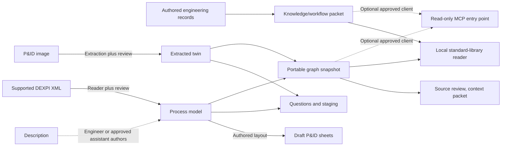

# Supported workflows and formats

Build from your records in reviewable stages: create a supported draft model, review and enrich it, then choose
drawings, graph/context, platform staging and approved data connections. This reference gives each tool's exact
file contract. The [tool selector](../README.md#start-wherever-you-are) routes your inputs; the
[tutorials and case studies](README.md) show the method and its public evidence.
The [structural-change tutorial](../examples/engineering-change/README.md) exercises a subsequent model/layout
revision through the existing description, generation and context contracts below; it adds no new importer.

## First choose what the question needs

- **Your plant's draft structure:** use the [P&ID image](../examples/own-drawing/README.md),
  [description](../examples/from-description/README.md) or [DEXPI XML](../examples/from-dexpi-xml/README.md) route.
  Review the resulting model and its source evidence before enriching or connecting it.
- **Controls or recorded behavior:** use loop records or historian CSVs directly, then relate the results to
  reviewed asset identities. Recorded data complements the structural model; it is not itself a process model.
- **Maintained source-linked knowledge:** attach questions and answers to supported models with the context
  register, or author a selected [knowledge/workflow packet](../examples/engineering-onboarding/README.md)
  without an asset model. Read selected packets through Python or an approved MCP client.
  The [local capture tool](../examples/engineering-onboarding/contribution-loop/README.md) accepts that unbound
  packet, a `knowledge-capture-1` change request and explicitly supplied complete UTF-8 source files. It creates
  a new `engineering-onboarding-1` packet, exact before/change copies, a readable handoff and a hash receipt;
  it appends authored claims and sources without editing prior records. Declared combined-source dependencies
  use the existing reader's review diagnostics. Source interpretation, semantic dependencies and company
  acceptance are supplied work, not generated decisions. PDF/Office extraction and bound-companion reconciliation
  are outside this route.
- **Document clarification:** use the [plain brief](../examples/first-pilot/README.md) with permitted sources and
  a reviewer. A drawing, graph or server is optional when the job only needs a qualified source answer.

## Files with different jobs

| File shape | Role | Important boundary |
|---|---|---|
| **Onboarding packet (`engineering-onboarding-1`)** | Authored sources, roles, glossary, system references, claims and workflow/practice records for a selected assignment. | Supplied source pins and review states do not establish truth, authority or permissions. It does not convert into a process model or graph. |
| **Process model** | Equipment, streams, instruments and controls, authored from sources or read from supported DEXPI XML; for example `data/te_process_model.json`. | Authored or reader-derived interpretation needs review. Detailed P&ID sheets also require a separate authored layout. |
| **Extracted twin** | Assets and connections read from a drawing; for example the own-drawing bundle's `plant_model.json`. | Interpretation, source revision, identities and connections need review. Its logical SVG is not a detailed P&ID. |
| **Portable graph (`twin-graph-1`)** | Exported identities, typed relationships, sourced claims and optional questions for review/access. | It is a snapshot and a one-way export. No general graph-to-generator-model inverse exists. |

The diagram omits setup and optional evidence inputs; the table below states each contract. Image extraction
requires an approved model interface. Supplied offline answers let you try the examples without running a model.
Detailed layout is authored. Neither arrows nor a passing check establish engineering truth.
Eligibility and represented fields still matter. Known unplaced source roles can support a question while
equipment placement stays unknown. Public C03 now yields C3 for its retained ESV-3712 final element without
inventing a controller or owning equipment. The [unplaced-role handoff](../examples/graph-export/unplaced-dexpi/question-handoff/README.md)
shows the question-to-answer tool path. If no relevant catalog trigger fires, keep a plain source-question brief.
The older converted-key DEXPI adapter produces an extracted twin through its separate contract below.

## Tool input and output contracts

[Maintenance export intake](MAINTENANCE_INTAKE.md) accepts two user CSVs plus an explicit `maintenance-intake-1`
profile, normalizes only mapped fields into one-map contracts, and returns a sourced offline manager packet.
Its original-row map, source revisions, complete queue and proposed actions accompany the report. A verified
`--previous` packet enables explicit graph/finding comparisons without overwriting earlier evidence; disappearance
does not establish accepted correction. No drawings, live connector or MCP service are required.

| Tool or route | Current input | Output and integration boundary |
|---|---|---|
| `dexpi_reader.py` | Supported DEXPI XML | A Native process-model-shaped JSON plus an omissions/placement report by default. Explicit `--capture-source` adds the complete policy-filtered structured-source packet and coverage summary. Vendor dialects, mapped classes and downstream eligibility need review; not every source role is used by every generator. |
| `source_handoff.py` | An explicitly selected process model already containing a captured `source_evidence` packet | Optional local Native/evidence/manifest trio and bounded inspection brief. No automatic capture, original-document fetching, company publication or source-aware graph/context/MCP consumer. See the [handoff guide](../examples/source-handoff/README.md). |
| `dexpi_to_twin.py` | The pre-adapted DEXPI sheets/keys contract | An extracted twin/review bundle. This route is distinct from the direct XML reader and does not import arbitrary CAD formats. |
| `description_workflow.py` | UTF-8 text for `prepare`; an engineer/approved assistant's model+layout+quotation JSON for `check` and `build` | Source packet and validation feedback, then draft sheets, questions, graph, staging and full supplied-record/source-line review sheets. Interpretation/layout remain authored and all review rows start unreviewed; no model API, automatic detailed layout or tested Copilot tenant. See the [connected example](../examples/from-description/README.md#try-the-connected-route-offline). |
| `draw_pid_from_model.py` | Process-model fields plus an authored drafting-layout JSON | Detailed draft PNG/SVG P&ID sheets and a key. No automatic detailed layout or general graph/extracted-twin conversion into this drawing contract. |
| `generate.py` | This repository's process-model JSON or extracted-twin JSON | Platform staging and the outputs supported by that model kind. A `twin-graph-1` file is not a direct generator input. Signal mapping and native acceptance remain separate steps. |
| `question_engine.py` | Process-model or extracted-twin JSON; optional loop list and equipment schedules; explicitly selected `--io-list` CSV revisions for extracted-twin mappings | Questions, asset references and collection requests. Selected mapping descriptions retain their source and qualifiers for review. Findings propose investigations; they do not mutate the model or establish savings. |
| `graph_export.py` | Process-model or extracted-twin JSON, with optional ordinary question-engine questions or captured review records ([association steps](REVIEW_HISTORY.md)) | `twin-graph-1`, including the source/status information represented by the input. Bound enriched questions are refused: use their complete enriched graph/context pair or explicitly refresh the preserved register. Review records remain unbound unless individually associated; this does not authenticate approval. It is an export, with no general graph-to-process-model inverse. |
| `apply_review.py`, then `generate.py` | A supported working model and its engineer-filled `OPS_` review sheet | The existing [local model-correction route](REVIEW_LOOP.md): preview with `--dry-run`, apply whitelisted corrections with old values and review history, then regenerate. Apply updates that working model in place; valid rows may persist when other rows refuse. Preserve the base and inspect its diff/change record. A hub integration must stage the resulting changes under its authority rather than treating local CSV entries as organizational acceptance. |
| `map_points.py`, `map_pi_points.py` | Extracted-twin instrument IDs and a separately reviewed OPC I/O list or PI reference CSV | Supplied address assignments followed by regeneration. For OPC, `--record-dir` selects a private receipt folder; the omitted default remains repository `out/mapping/`. Native process-model target fields need separate authoring/configuration. Assignments do not establish installed signal identity or native acceptance. |
| `statements.py` | `twin-graph-1`, with supplied source images/report and optional machine-check model | Statements, samples and review material. Applied reviews change statuses and add review events; they do not change engineering values or authenticate the reviewer. See the current [binding and application rules](STATEMENT_REVIEW.md). |
| `context_register.py` | Process model, extracted twin or graph, questions and a manifest of actual local source documents | `context-register-1` and enriched graph/questions. Treat local answers and ownership history as a review packet when transferring into an organizational authority. It does not update the original working model. |
| `knowledge_snapshot.py` | One explicitly selected `engineering-onboarding-1` JSON packet | Three standard-library reads: overview, metadata lookup and complete records, including workflow instructions and their source qualifications. Source references are not fetched; workflow steps are data. No company authentication, source-authority decision or graph conversion. |
| `serve_snapshot.py` | Selected onboarding packet and/or `twin-graph-1` graph; the graph may have an explicitly selected, hash-bound `context-register-1` sidecar | Three knowledge reads when selected; existing graph/context tools retain bounded asset, relation, question and complete history readback. Scopes coexist without merging record identities. Restart to load a reviewed version. No automatic source fetching, workflow execution or shared company authentication. |
| Historian CSV tools | Recorded data in the documented CSV shape | Analysis and replay of the supplied history. Joining channels to canonical plant assets is a separate mapping task; an unusual trend is not a validated diagnosis. |
| `batch_analysis.py` | Recorded batch CSV (`batch_id`, elapsed `time_s`, selected signals), strict phase/unit plan, optionally selected `twin-graph-1`; V2 explicitly declares interpolation and quality columns/policy | Phase extrema, time-weighted observed means and supported rate integrals with time coverage; exact graph equipment/instrument ID checks when selected. Supplied mappings/units/phase truth remain unverified. JSON/Markdown sidecars, no automatic graph/context/MCP update or live data connector. See [batch analysis](../examples/batch-analysis/README.md). |
| `check_analysis_basis.py` | Saved V1/V2 batch-analysis JSON plus explicitly selected original CSV/plan and graph exactly when originally bound | Read-only input/code fingerprint comparisons and complete typed-result reproduction when they match; changed/invalid selections have separate exits. No automatic dependency monitoring, revision selection or context refresh. See [basis check](../examples/batch-analysis/basis-check/README.md). |
| `join_batch_records.py` | Operator-selected `batch-record-join-1` manifest; exact analysis/CSV/plan/optional graph and normalized batch/event/executed-recipe/lab/outcome CSVs | Declared record/availability/quality alignment, withheld incomplete metrics and descriptive differences; separate complete audit/raw captures. `--check` binds upstream inputs and bounded method pins, then reproduces the typed result. No fuzzy/live ingestion, causal/yield inference, accepted outcome or company authority. See [record joins](../examples/batch-analysis/record-joins/README.md). |
| `estimate_impact.py` | A strict JSON specification containing measurements and site constants, or explicitly requested public defaults | A first-draft calculation with assumptions and source notes. The model alone does not supply the measurements; generator provenance belongs in a sidecar rather than unrecognized calculation fields. |
| `pipeline.py` | The repository's declared stages, inputs, code and configuration | Freshness and rebuilds for its configured research demonstrations. An organization's own recipes and service orchestration need an explicit implementation; the existing stage list is not a universal plant integration. |

Drawing manifests identify their generator, model and layout with the drawer's existing text-hash rule:
CRLF pairs are folded to LF; other bytes remain significant. The topology verifier uses that same rule and
still checks the recorded key networks. This does not normalize original source-document hashes, context
source pins or bundle inventories, and a matching manifest does not establish engineering correctness.

## Optional DEXPI source handoff

The [direct XML reader](../examples/from-dexpi-xml/README.md#optional-capture-structured-source-evidence)
keeps its existing Native-only default. Its Native model can still go straight to `graph_export.py` through the
existing route. Graph export, context registers and snapshot/MCP readback do not acquire source-packet support.

For a manual evidence handoff:

1. Explicitly read the XML with `--capture-source` (Python: `capture_source=True`). Keep the original XML/images
   separately and review the conversion report, exclusions and mapped/unmapped counts. A custom
   `--source-document-id` / `source_document_id` requires capture; it never enables capture implicitly.
2. Keep that complete embedded packet, or use `source_handoff.py export` to write the Native projection,
   complete policy-filtered evidence packet and hash-bound manifest into a new version folder. The utility
   refuses a Native-only input; it does not find or capture missing evidence.
3. Select all three files explicitly for `source_handoff.py inspect`, then transfer the permitted files and brief
   through the company's approved route. Follow the [commands and failure limits](../examples/source-handoff/README.md),
   including inspection after transfer; the trio is not an atomic publication or a company access service.

The packet preserves eligible structured XML and parsed attribute values, with explicit Native mappings and
unmapped occurrences. It excludes defined presentation/geometry subtrees and protected named-person fields;
text/tail presence counts do not retain their payloads. Complete capture is therefore not all original XML,
a round trip, general PII clearance or plant truth. Occurrence IDs identify source provenance, not shared
engineering identities. The company-managed system owns ongoing identity, access, review, decisions and
published revisions; these local files are an inspectable starting point for that handoff.

## Carry a finding forward

Keep the source revision and locator, exact asset/finding IDs, unresolved evidence and intended next owner with
the result. The [question brief](../examples/first-pilot/README.md) is the smallest handoff. The optional
[context register](CONTEXT_REGISTER.md) retains supplied answers and revision dependencies in local files.
Its answers do not edit the generator model; use the separate reviewed model-correction route when appropriate.

Ordinary `question_engine.py` questions can be attached by `graph_export.py --questions`. Once the context register
adds answers and a `context_register` content binding, carry `enriched_graph.json` and `context.json` together
directly to the consumer. Do not pass `enriched_questions.json` back to the graph exporter: rebuilding a full or
core graph cannot validate its inherited answer freshness or preserve the complete decision history. The exporter
refuses that input before writing. For changed sources, model or questions, explicitly refresh through
`context_register.py` with the preserved register, then use the new bound pair; the
[context handoff instructions](CONTEXT_REGISTER.md#versioned-handoff-and-limits) describe that route.

For continuing company use, [the lifecycle](CONTEXT_LIFECYCLE.md) owns the intended responsibility and return
path. [Connectivity](INTERNAL_CONNECTIVITY.md) owns client approval, deployment and network boundaries.
Company authentication, accepted imports, live process-data connectors and automatic document updates are
separate integration work. The MCP starter holds the explicitly selected knowledge and/or graph/context files
at startup; it does not provide a shared company knowledge service.

For individual tool evidence use [FEATURES.md](FEATURES.md). For results use [RESULTS.md](RESULTS.md).
The [demo deliverables](DELIVERABLES.md) compare TE and OPEN100 research outputs; they do not promise those
screens, tours or isolation mockups for a new plant.

## Bounded editable CAD exchange

[CAD handoff](../examples/cad-handoff/README.md) uses `cad_handoff.py` on a declared DXF block-attribute profile.
It retains the original, compares a proposed attribute edit on readback and emits unverified attribute context
(`cad-context-1`) and candidate CSV. These are not native DWG/intelligent-P&ID project exports.

For existing equipment-data corrections, `cad_exchange.py prepare` emits an immutable DXF plus complete catalog
and local review form; `apply` accepts source/catalog-bound JSON proposals and uses `cad_value_patch.py` to
preserve all bytes outside declared attribute spans. The [data review guide](../examples/cad-handoff/data-review/README.md)
has the agent/browser commands. A native CAD UI is not required for this metadata operation. Native visual,
interactive drafting and full-save acceptance remain separate claims; full returned DXFs are not imported here.

The tutorial's explicit identity mapping projects the packet to a draft `one-map-sheet-1` with drawing-reference
attributes. Normal `one_map.py build` and `changes` then produce before/proposed `twin-graph-2` snapshots and a
revision report at the same mapped position. CAD attributes remain prefixed `cad_`, unverified and sourced;
no pipe/control relationship or installed-state authority is inferred. The original DXF remains alongside the
projection. This is an explicit one-way publication, not automatic or bidirectional synchronization.

`cad_handoff.py review` accepts an original/returned pair in that profile, plus an optional hash-bound edit plan,
and writes a [receiving packet](../examples/cad-handoff/receiving-review/README.md): exact drawings, full strict
comparison, planned/unexpected attribute values, explicit changed fields/layouts and every unresolved strict row.
It returns exit 1 for a completed packet with differences, 0 only for strict decoded equality under the plan,
and 2 for input/preparation failure. Neither completed result establishes acceptance or promotes a context revision.
Two saved native returns reproduce offline; their original strict failures (335 and 344) remain failures.

Native editor open/edit/save, opaque-content fidelity, receiving-company approval and subsequent accepted
revision behavior remain to be qualified using the actual CAD tool/version and [acceptance plan](ACCEPTANCE.md).
