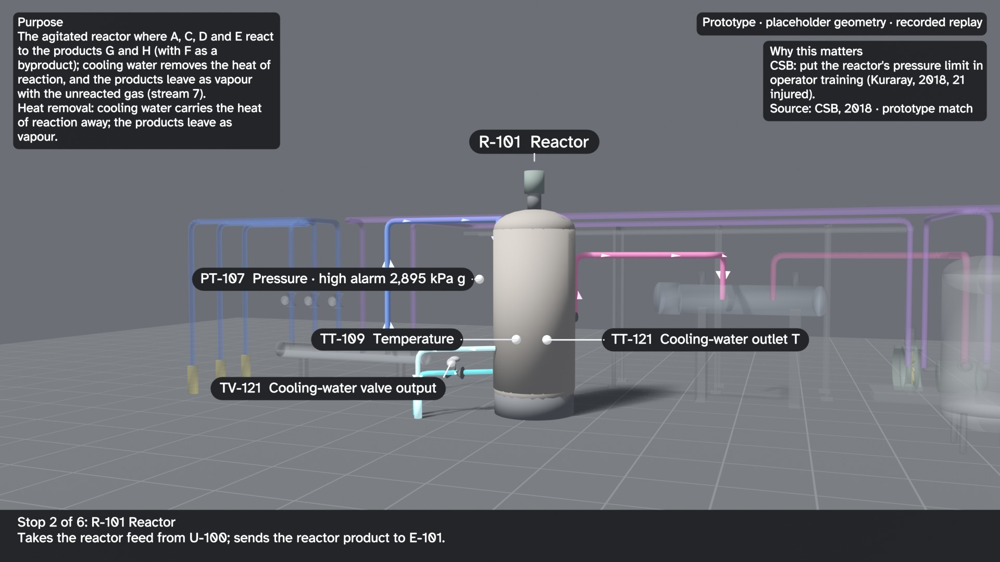
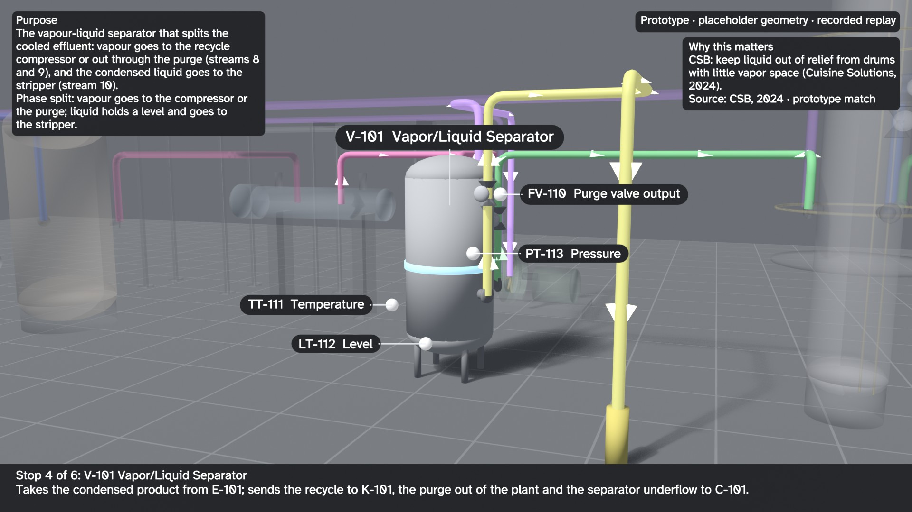
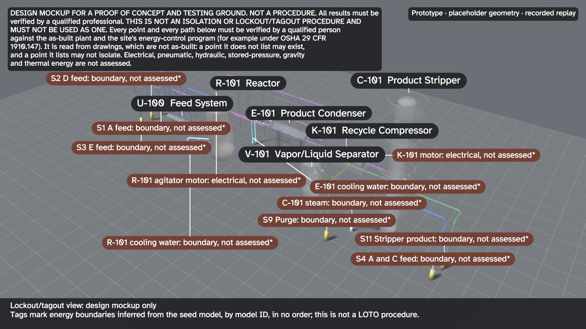

# 3D operator orientation tour: review stills (proof of concept, not reviewed)

**Case-study visualization.** Use these stills to see how a reviewed asset model could support orientation and
source-linked explanations for your team. Build your starting model with the
[own-P&ID tutorial](../../examples/own-drawing/README.md) or [description tools](../../examples/from-description/README.md).
The scene and narration below were assembled for TE; making a tour of your plant requires your own scene,
geometry and reviewed explanations in addition to the reusable model/export steps.

These are review stills from a proof of concept that renders the twin's process model as a 3D walkthrough for
operator orientation. Geometry, sizes, elevations and pipe routes are placeholders; tag colours come from the recorded
Tennessee Eastman replay, not a live plant. The narration and the tour's short function lines were written with AI
assistance from the data files; each purpose sentence comes from `data/te_unit_purposes.json`, which cites the
simulator lines it restates. Nothing here has been reviewed by an operator.

The stills were re-rendered on 2026-10-28, after the control valves were renumbered to their loops (journal entry 51),
with the review corrections of 2026-10-15 re-applied (V-101 and K-101 callouts, the overhead rack corridor, the
header bore and an illustrative compressor impeller) (`python scripts/pipeline.py rebuild --from te.tour`, with
`BLENDER_EXE` set; Blender 5.2.2, stills only, no video). They show the source-checked topology (the purge leaves
from the separator V-101, with FT-110, FV-110 and AT-129) and the Atkinson Hyperlegible label font. The OCR
read-back was re-run on 2026-11-11 against the current published stills: `label_truth.json` is rebuilt from
`label_boxes.json` (`python drafts/3d-tour/ocr_readback.py --truth`), and `ocr_readback.json` comes from
`ocr_readback.py` (rapidocr 3 in a scratch virtual environment, classifier off: 57 labels, mean character accuracy
0.984, 42 of 42 tag and unit IDs read in the crop and in the whole frame; the LOTO card is read back at 1.0). Twelve stills were rendered and measured; eight review JPEGs are committed.
The render verifier failed none of its 17 checks on
all twelve: 15 pass, and 2 are informational (drawing coverage, and OCR, which was not run). See
[verification.md](verification.md) and the label boxes in [label_boxes.json](label_boxes.json). The 2026-10-13
[before/](before/label_boxes.json) evidence remains a historical control of the old label rules; it was not re-rendered
with the new cutaway geometry.

This review cut anchors the V-101 and K-101 callouts on their own machine bodies, adds a paired-column overhead
recycle corridor, and opens the header bore and compressor casing. The radial impeller and all rack dimensions are
illustrative placeholders, not verified plant construction or compressor-type evidence. Purpose cards sit in front
of nearby geometry; the render audit now checks them for occlusion by ghosted parts as well.

| Still | What it shows |
|---|---|
|  | Elevated overview, normal replay |
|  | Reactor stop: purpose card, key tags, operating alarm, public-incident citation |
|  | Feed header with an illustrative open bore |
|  | V-101 callout ending on the separator body |
|  | K-101 cutaway with an illustrative radial impeller |
|  | Fault 6 at the reactor pressure high alarm (+294 min) |
|  | Process flow coloured by service, arrows showing direction |
|  | Lockout/tagout view design mockup (re-rendered 2026-11-11). Energy boundaries are inferred from the seed model; each tag is led by the model ID of what it marks, not a number. The card prints the fixed mockup status (a proof of concept and testing ground; every result to be verified by a qualified professional). Which device isolates each is not assessed, and control valves are not positive isolation. This is not a procedure. A real LOTO procedure comes from the site's energy-control program (OSHA 1910.147), its verified P&IDs and an authorized person. |

Not checked on these stills: the verifier's own tesseract OCR check (tesseract is not on the render machine's
PATH; the separate read-back above did run). A person still has to look
([review kit checklist](../../docs/review-kit/CHECKLIST_3D_STILLS.md)).

Not built yet: animated flow and per-asset mechanism animations, and the narrated video (not re-rendered since the
review; it must not be until the stills are approved).
