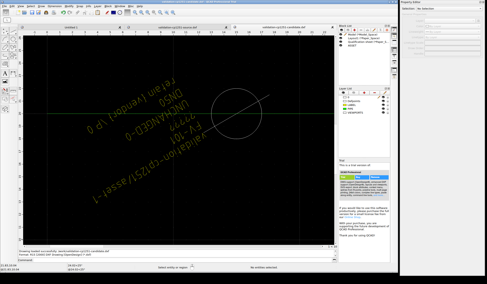
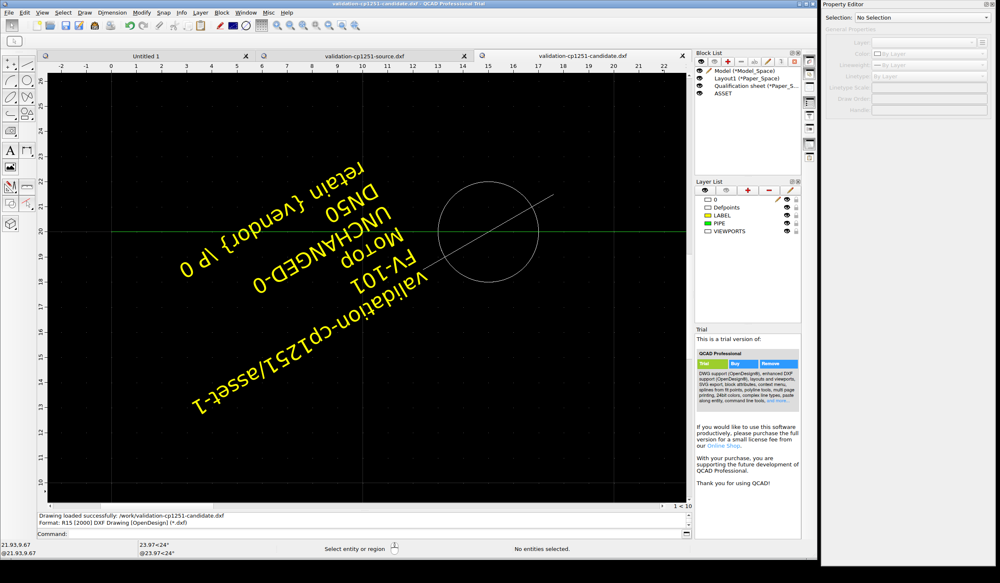

# Native font mapping and complete asset frames

**Useful exposed development, not whole CAD qualification.** A process-local display-font
mapping makes the Cyrillic and mixed Unicode labels readable in the inspected Linux native
views without changing a drawing byte. Measuring native bounds **after** the mapping and
using the union of source/candidate bounds keeps both versions in one complete asset frame.
The equipment-data [agent/local-form route](../../data-review/README.md) requires no native
CAD UI for proposing or applying these existing attribute changes. A native receiver remains
useful for testing what a recipient actually sees and can edit; that is a separate obligation.

## Design and evidence

The [plan](../FONT-VIEWS-9-PLAN.md) was committed at `5767878` before execution; the
[native reader/camera and capture freeze](FREEZE.json) at `9c64546`. No input was fresh:
all three authored sources/candidates were already exposed in Linux run 7. CP1251 has two
rotated assets, Unicode three rotated assets, and the long-label drawing one asset. All six
attributes per asset are retained, including foreign vendor data. Only the planned MODEL
values differ in the candidates. The original strict comparator, source/plan reconstruction,
sources, plans and old tests remain frozen.

Two fresh processes used the same pinned native image and copied local terminal run-7
configuration. The first uses the publisher's default Standard CAD font. The second adds
`-font-substitution Standard "DejaVu Sans"`. This is an explicit **display profile**, not a
source-font replacement, drawing save, original-typography claim or repair to a missing font.
No font installation, trial-mark removal or license/clock alteration occurred. Publisher
executables, font files, native settings and DBus addresses are not distributed.

The native API reads exact values, parent/ICT_ID identities, fonts and bounds after startup;
it activates actual GUI documents and sets the camera. It never changes entities or saves
or exports a drawing. This experiment therefore does not add a new native UI edit/save run.
The [earlier real property-edit/save/close/reopen run](../linux-native-7/README.md) remains
separate, with its 287 strict full-save differences still failing.

For each asset, bounds of the parent INSERT and all attributes from **both** roles are united,
then padded on each side by 20% of the greater dimension, minimum two drawing units. Both
roles use the same frame/camera. A whole-model context pair is also retained for each case.
Per profile this is 18 views: six overview and 12 asset views. The two accepted batches total
36 final full-desktop images, with all consecutive stabilization frames and native receipts.
The 72 unique native field observations per profile (144 total) all match source/candidate
snapshots, including unchanged and foreign values. Repeated cached receipt fields are not
counted as additional observations.

The X11 desktop is 2400x1400; the main window 1960x1320 with the property editor beside it.
A read-only accessibility observation records the actual Drawing View rectangle as
`[114,175,1533,1032]`. The correction note's earlier left-edge estimate of 113 is off by one;
the offline pixel comparison uses the observed rectangle, not that estimate. Projected
native bounds fit inside the canvas in every accepted view. Full screenshots retain the
trial panel, source rotation, background geometry and existing overlaps.

## Results and remaining failures

| Observation | Result and limit |
|---|---|
| Default Standard font | Its pinned CXF character headers lack 13 required Cyrillic characters. Native views show missing-glyph question marks; absence of a Qt glyph field for this CAD font is not a glyph pass. |
| Explicit mapped font | Native font probes resolve DejaVu Sans; Qt reports coverage of every supplied character across all 72 unique fields. Direct inspection of all target asset views finds complete Cyrillic/mixed Unicode labels and both 81-character source / 107-character candidate long lines. This is assistant observation, not independent human acceptance. |
| Context overviews | Complete context, but labels are too small for character review. Asset views supply the readable check. |
| Existing layout | Background linework crosses labels on the second rotated asset in both multi-asset sources/candidates. Mapping does not repair this inherited overlap. |
| Matched mapped canvas pixels | In all nine mapped source/candidate pairs, every changed canvas pixel lies within the unexpanded native bounds of the planned MODEL labels. This is a development diagnostic on these inputs, not proof of text correctness or a frozen general visual scorer. |
| Default long overview | 62 changed pixels lie outside the exact MODEL bounds. All fall within a two-pixel expansion. **The 62 remain unresolved; no tolerance waives them.** Other eight default pairs have zero outside the exact boxes. |
| Drawing bytes | All six retained inputs in all three process folders match their pre-run pins. Three candidates rebuild with strict zero and the separate source/plan byte reconstruction reports zero unplanned changes. |
| Other original gates | Five missing-main-viewport paper-layout failures, native full-save preservation failures, original intended typography, a frozen general preparation method and fresh reserved native validation remain open. No engineering/company release or plant result. |

The [pixel diagnostic](pixel-diagnostic.json) reports raw different-pixel counts/bounds and
both exact and two-pixel-expanded label-box counts for **all 18 pairs**. The expansion is
an exposed diagnostic, never an acceptance threshold. The original images are unmodified;
box masks exist only in the analysis. No comparison between the default and mapped profiles
is treated as geometric equality: a font mapping legitimately changes measured text bounds.
The [visual review](VISUAL-REVIEW.json) names all 36 directly inspected accepted images and
the observation limits. Font coverage is not optical recognition or original-font fidelity.





The [long-label](long-mapped.png) and [mixed Unicode](unicode-mapped.png) screenshots are
also byte-exact copies of retained final captures, not polished replacements.

## Failed and interrupted attempts stay visible

The original complete default batch used a pointer traversal point below the canvas. Its
18 final images, 36 frames, receipts and original capture script remain in `raw/default/views/`.
The [declared correction](CAPTURE-CORRECTION.md), commit `667025d`, moves through the padded
canvas margin `(1590,1180)` before moving outside `(2380,1380)`. During its first execution,
the agent mistakenly sent native Quit before the capture process finished. That process
later reported exit 1. Its partial 14 final images/28 frames and receipts through request 113
remain in `raw/default/views-corrected/`; it has no completed actions receipt and is excluded
from matched-profile conclusions. Native exit 0 alone did not make that capture complete.

[The interruption note](PREMATURE-QUIT.md), commit `cb3d2cb`, preceded a fresh-container repeat.
The corrected default batch (session 22437) and subsequent mapped batch (72745) each separately
reported capture exit 0 **before** native Ctrl+Q and application exit 0. The default process
finished before the mapped process started. No uncertain/live process was restarted.
`HOST-NOTES.json` is explicitly a transcription of observed tool results, not continuous video;
raw images, per-command actions, native receipts, logs and terminal container state are retained
separately. Later font/geometry observers read metadata only and did not alter either drawing.

## Reproduce the retained evidence offline

```sh
python examples/cad-handoff/qualification/check_font9.py
python -m unittest discover -s scripts -p test_cad_linux_evidence.py
```

No Docker, network, commercial executable, account or CAD UI is required. Requirements are
the repository's normal Python dependencies (ezdxf and Pillow). The checker uses the bounded
safe archive reader, binds exact inputs/executed recipes, reconstructs candidates, checks
native values/fonts/cameras/projected bounds, independently decodes stable frames and
recomputes all 18 pixel diagnostics. Seven semantic receiving controls reject a wrong planned
value, lost foreign value, missing glyph, clipped camera, wrong active document, an unplanned
canvas pixel and omitted view. An offline pass verifies retained observations, not a new GUI run.

The [inventory](INVENTORY.json) pins every logical file and the 13,612,032-byte lossless XZ
archive (SHA-256 `4611c116cd8ec48bd0ca14ca0ed108947dd7060b7dc784a65702dd61f3179ae3`).
It retains 53,186,420 raw bytes, including the unsuccessful batches. The [summary](summary.json)
keeps `whole_cad_qualified: false` and lists the open gates. The packager uses an explicit
allowlist; original evidence is never overwritten. Font metadata pins Standard.cxf
(`6e482dd6…`, 23,818 bytes) and DejaVuSans.ttf (`ae7b7855…`, 759,720 bytes); these files stay local.

Native image: `sha256:bb4390214744897de88b2198f0cbf812aec4be42923311298e7a5e3a5646bef8`,
QCAD Professional trial 3.33.1 Qt5 on Linux. The publisher package and source references are
in the [prior environment receipt](../linux-native-7/ENVIRONMENT.json) and pre-execution plan.
Public source explains the font-substitution API; actual font metrics and native screenshots
provide the separate observations. Fresh qualification must freeze the complete chosen
method and reserve new inputs before execution; these exposed fixes cannot serve as holdouts.
