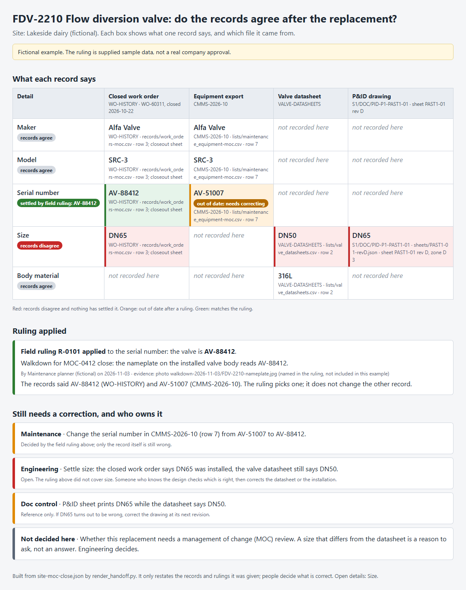

# One replacement, several records, one checkable handoff

**Fictional tutorial using existing reusable tools.** No network, account or model call. It follows the existing
pasteurizer example; this is not a plant result or a timed human-benefit result.

The question: **after FDV-2210 was replaced, do the records describe the same installed valve?**

The closed work order records model SRC-3, serial AV-88412 and DN65. The equipment export still has the old
serial; the valve datasheet still says DN50. A supplied fictional walkdown ruling cites a nameplate observation
and settles the serial disagreement, while leaving a correction request for Maintenance. It does not settle the
size/design basis or decide whether the replacement requires MOC.

## Run it from the repository root

Python 3.10+, standard library only. Choose an unused output folder for your run.

```sh
python scripts/one_map.py build examples/one-map/inputs/pasteurizer/site.json --out out/maintenance-handoff/before
python scripts/one_map.py build examples/one-map/inputs/pasteurizer/site-moc-close.json --out out/maintenance-handoff/after --decisions examples/one-map/inputs/pasteurizer/walkdown_rulings.csv
python scripts/one_map.py changes out/maintenance-handoff/before/graph.json out/maintenance-handoff/after/graph.json --tags FDV-2210 TT-2208 --out out/maintenance-handoff/changes
python scripts/one_map.py affected --tags FDV-2210 TT-2208 --closeout out/maintenance-handoff/before/graph.json out/maintenance-handoff/after/graph.json --out out/maintenance-handoff/closeout
python examples/maintenance-handoff/render_handoff.py --after out/maintenance-handoff/after --tag FDV-2210 --out out/maintenance-handoff/HANDOFF.html
```

The last command writes one web page, `HANDOFF.html`, that opens in any browser with no network: each record's value
beside the file it came from, disagreements highlighted, the ruling applied, and what still needs a correction and
by whom.



## Inspect the work product

| File | Check |
|---|---|
| `HANDOFF.html` | The same answer on one page for a reader who will not open markdown or CSV. Re-generated from `after/`; it decides nothing. |
| `after/conflicts.md` and `after/queues/review_queue.csv` | Source disagreement, field-ruling history, owner correction request and unresolved datasheet discrepancy. |
| `changes/changes.md` | Before/after tags, work order, drawing and document revisions; earlier evidence remains available. |
| `closeout/closeout.md` | Changed and unchanged affected records, missing PM plan and remaining manual confirmations. |

The existing [committed outputs](../one-map/expected/pasteurizer-moc/) let you inspect the result without running
commands. The [complete walkthrough](../one-map/README.md#the-pasteurizer-through-an-moc-pid-revision-moc-open-and-close-work-order-walkdown)
identifies every input and moment in the change. A ruling CSV is supplied provenance, not an authenticated
company approval; the example's nameplate reference is fictional, not a retained real photograph.

## Substitute your records

Follow [the maintenance starting guide](../../docs/MAINTENANCE_START.md) and [one-map contracts](../../docs/ONE_MAP.md).
Retain the site/unit namespace, source versions, work-order closure dates, installed model/serial/size, record
owners and the scope covered by each export. Use a permitted field observation to establish equipment identity.
Do not join the unrelated public photograph in [photo-to-record](../photo-to-record/README.md) to this valve.

Have an actual recipient reconstruct the answer and make a correction request. Then read an accepted correction
back from the receiving system and exercise another change using [the acceptance protocol](../../docs/ACCEPTANCE.md).
Those are the next evidence gaps; another passing fictional run does not close them.
