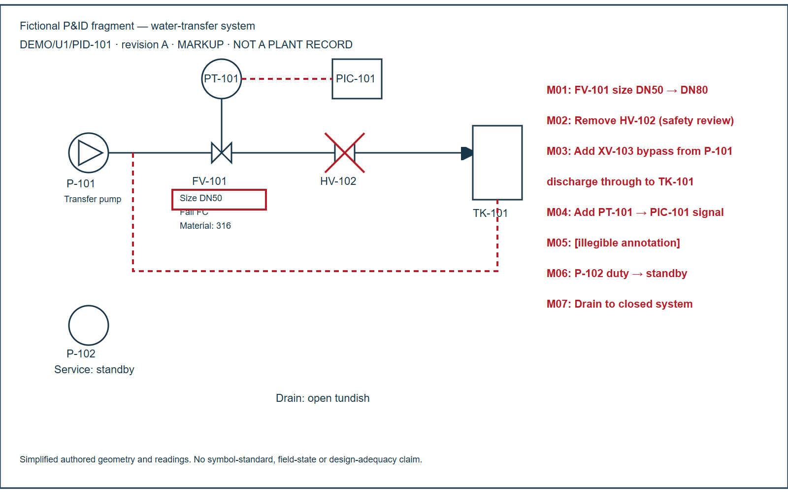
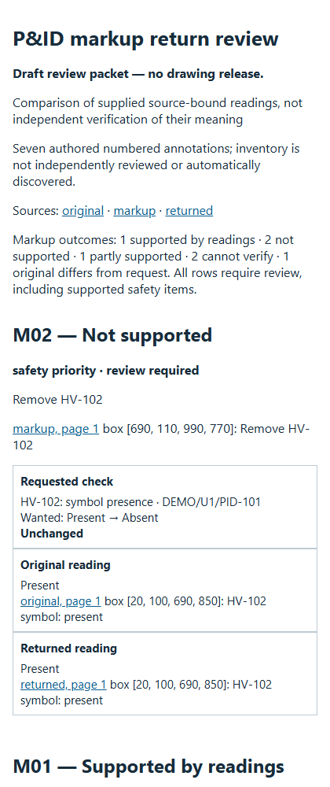

# Check a consultant's returned P&ID against your markups

A drawing can have the new revision letter and some of the requested work while still missing an important
connection. This fictional water-transfer example makes that problem concrete. Compare the
[original](inputs/original.svg), [markups sent out](inputs/markup.svg) and [returned revision](inputs/returned.svg).

| Request | Finding from the authored readings |
|---|---|
| M01: change FV-101 to DN80 | Supported. |
| M02: remove HV-102 | Still present; safety-priority review remains first. |
| M03: add a bypass through XV-103 to TK-101 | Valve/inlet added, but the outlet stops short of the tank: partly supported. |
| M04: add PT-101 → PIC-101 signal | Both tags exist; requested signal remains absent. |
| M05: illegible annotation | Cannot verify; clarify the instruction. |
| M06: duty → standby for P-102 | Original already says standby: resolve the baseline. |
| M07: drain to closed system | Returned note is represented as unreadable; no value guessed. |

**Other observed change:** FV-101's fail action changed from FC to FO without a request. One original material
reading has no returned counterpart and stays a coverage gap. Both also enter the review CSV.
These are fixture findings, not evidence about a real plant or consultant.



## Try it without accounts or extra packages

From the repository root with Python 3.10+, choose a new output directory:

```sh
python -S scripts/check_pid_markups.py --manifest examples/pid-markup-review/inputs/manifest.json --out ../my-markup-review
```

Open `REPORT.html`, `review_queue.csv` and `result.json`. The
[saved Markdown report](worked/REPORT.md) and [full saved result](worked/result.json) show what the tool actually
produced. The portable output includes exact sources and prepared requests/readings; it can be rechecked using
its own `manifest.json` after relocation. [Use your own records](../../docs/PID_MARKUP_REVIEW.md), or follow that
guide's copyable prompt with an approved assistant already able to read your documents. No MCP or CAD UI is
required for this comparison.

## What was simulated and what ran

The [plan](../PID-MARKUP-REVIEW-PLAN.md) was committed at `2d90314` before implementation.
The separately written [acceptance key](ACCEPTANCE.json) was committed at `89c2845` before the first run.
The [fixture builder](build_fixture.py) authors simplified SVG drawings and normalized observations from one
fictional design. **No model interpreted a PDF, handwriting or drawing image in this example.** This tests
comparison, source binding, refusal behavior and presentation, not independent visual-reading accuracy.
Illegibility is an explicit fictional condition, not an OCR performance result.

The real standard-library CLI produces the packet; nine regression tests exercise imperfect/corrected returns,
missing negative evidence, reversed signals, conflicting readings, uncertain identity, stale hashes/observations,
bad locators, duplicate sheets, typed mismatches, conflicting requests, path escape, HTML escaping, portable
replay and output collision. The corrected return supports five markups but still leaves M05/M06 open.
Prior packet/source bytes remain intact. There is no automatic drawing acceptance or map update.

The browser inspection used installed Edge through local headless Playwright after the browser connector timed
out. All source labels stayed inside the SVG frame; all seven report headings were present. Actual viewport and
scroll width were equal at both desktop 1500 px and mobile 420 px. The first preview led to readable field names,
stacked mobile tables and explicit process-flow arrows; the acceptance outcomes did not change. See
[visual observations](VISUAL-QA.json) and [provenance](PROVENANCE.json). These are author-session checks, not a
human tester study, verified engineering design or measured time saving.


