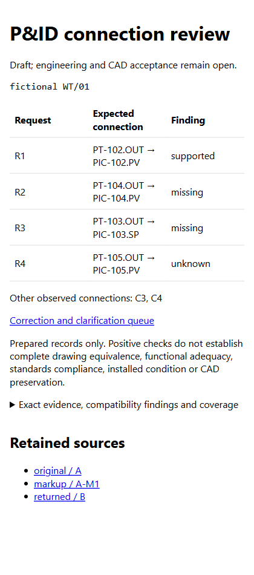

# The correct tag, connected to the wrong input

A consultant return can contain both correct instrument tags while preserving a connection to the wrong
controller input. This fictional example checks exact ports against explicit instructions, retains an
unrequested change, and leaves an unreadable area unknown. It does not recommend a control design.

From the repository root, with Python 3.10+ and no accounts, network or dependencies:

```sh
python examples/pid-port-review/replay.py --out ../my-port-review
```

Open `initial/REPORT.html`, assign the findings in `initial/review_queue.csv`, then compare the separate
`corrected/REPORT.html`. [Use your own prepared records](../../docs/PID_CONNECTIONS.md).

| Request | Initial return | Corrected return |
|---|---|---|
| R1: add PT-102.OUT → PIC-102.PV | Supported | Supported |
| R2: add PT-104.OUT → PIC-104.PV | Missing under declared complete coverage | Supported |
| R3: move PT-103.OUT from PV to SP on PIC-103 | SP missing; old PV connection C3 also flagged | Supported |
| R4: confirm PT-105 connection in unreadable area | Unknown | Still unknown |

C4 is an unrequested PT-106 signal in the initial return. O1 is explicitly allowed unchanged.
The example's PV-to-SP instruction is fictional intent for checking exact endpoints, not engineering advice.

## Evidence and honest limits

[PLAN.md](PLAN.md), [ACCEPTANCE.json](ACCEPTANCE.json) and the fixed source schedules/instructions were
committed in `1e9b761` before checker implementation. The key was separately authored; it was not produced by
a drawing renderer or the checker. The same assistant authored and saw the sources, key and implementation.
**This has no independent person review, blind test or visual-reading run.** Sources are fixed authored CSV/text,
not scanned P&IDs. Deterministic CSV parsing prepares records; completeness and the fixture asset inventory
are supplied assumptions. The catalog is CC0 fictional endpoint vocabulary, not an ISA-standard symbol library.

[Saved replay](worked/replay.json), [initial result](worked/initial/result.json) and
[corrected result](worked/corrected/result.json) are actual software execution. Each packet retains exact
sources, normalized records, catalog, hash bindings and a portable replay manifest. The old tag-only fact
representation matches the same tags despite the wrong input; the new fact distinguishes PV from SP.
That controlled representation comparison is not a measured accuracy gain of the old or new reader.

The first run failed at import because of a missing parenthesis. Its exact source and failure boundary are
retained in [attempt-1](attempt-1/FAILURE.json); no model, drawing or native CAD run occurred.
The successor replay used a new output path. [Regression tests](../../scripts/test_pid_connections.py)
exercise the prior key, corrected revision, old markup packet integration, stale observations, incomplete
coverage, incompatible/unknown ports and types, ambiguous identities, unsafe paths and portable receipts.

The checks produce a draft correction/clarification queue. They do not approve drawings, modify context maps,
prove engineering adequacy or qualify CAD exchange. All earlier CAD preservation failures remain unchanged.
Actual browser inspection of initial/corrected packets at 420 and 1500 pixels found four request rows and no
horizontal overflow. [Visual observations](VISUAL-QA.json) describe the scope; this is author-session QA.



For the reusable public methods and proposed rule admission criteria, read [the research review](../../docs/PID_RULES_RESEARCH.md).
