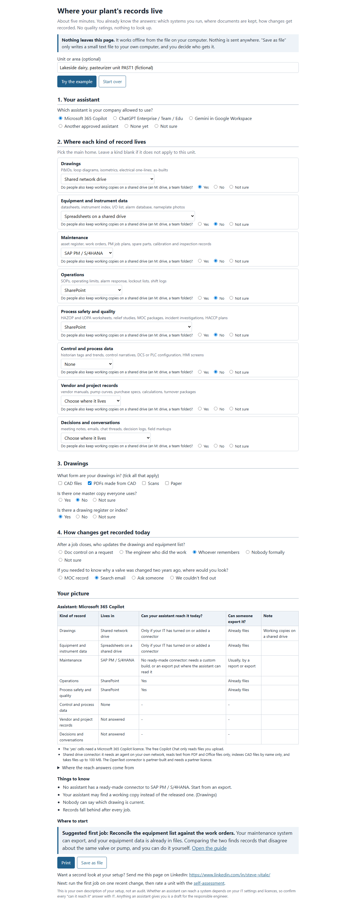

# Readiness self-assessment: worked sample

A worked example of the [engineering-records readiness self-assessment](../../docs/READINESS_AUDIT.md) on a fictional unit.

- [SAMPLE_REPORT.md](SAMPLE_REPORT.md): scope, where the Lakeside dairy pasteurizer unit stands on the
  [six conditions](../../docs/END_PICTURE.md), five next jobs with owners, and what was not examined.

- [worksheet.html](worksheet.html): where your plant's records live, as one offline page that takes about five
  minutes. Say which assistant your company allows, where each kind of record lives, whether people work from copies on
  a shared drive, and how changes get recorded. It shows what your assistant can reach today (each answer sourced to the
  vendor's own documentation), what to watch for and one first job. Print it or save it as a short text file. Nothing
  is sent anywhere. "Try the example" fills in the fictional Lakeside dairy.

The findings come from running the [replacement handoff](../maintenance-handoff/README.md) on its fictional
inputs. The report has no commands of its own. Tested on fictional inputs only: no plant has been assessed with this
format, and no time saving is claimed.
