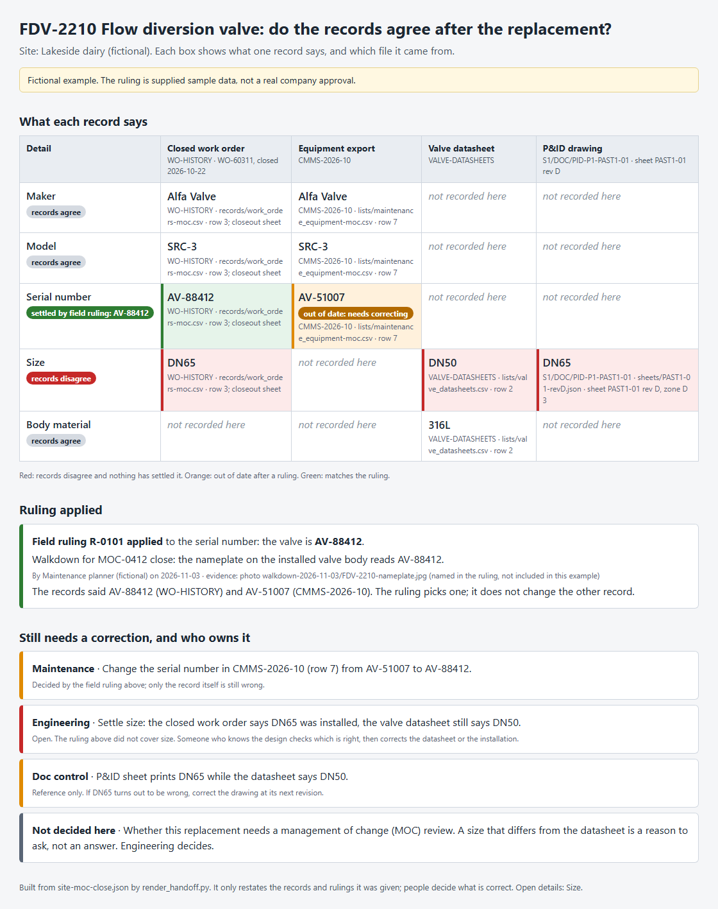

# Worked readiness self-assessment: Lakeside dairy, pasteurizer unit

**This report is fictional.** The Lakeside dairy, its records and its people are invented. The findings come
from running the toolkit's [replacement handoff example](../maintenance-handoff/README.md) on its fictional
inputs. No plant was visited and nobody was interviewed. It shows how to apply the
[self-assessment](../../docs/READINESS_AUDIT.md) to one unit's records.

## 1. Scope

- **Unit:** pasteurizer unit PAST1, one P&ID sheet (PAST1-01, revisions C and D).
- **Records examined:** maintenance equipment export, work order history, valve datasheets, instrument index,
  loop list, criticality ranking, HACCP plan, one SOP and the drawing register.
- **Question asked:** after valve FDV-2210 was replaced, do the records describe the same installed valve?
- **Method:** the commands in the [handoff example](../maintenance-handoff/README.md), run offline on the
  fictional inputs.

## 2. What we found on FDV-2210

- **Serial number.** The closed work order WO-60311 records serial AV-88412. The maintenance equipment export
  still says AV-51007. A walkdown ruling (fictional planner, 2026-11-03) cites the nameplate and settles it as
  AV-88412. The equipment export still needs correcting. Owner: Maintenance.
- **Size.** The work order records DN65 installed. The valve datasheet says DN50. The P&ID printed size is DN65.
  This stays open. It may need an MOC review. Owners: Engineering (datasheet), Doc control (P&ID note).
- **Missing PM plan.** FDV-2210 is ranked critical but has no PM plan row. Owner: Maintenance.
- **Records not yet confirmed.** The HACCP plan names FDV-2210 in a corrective action, and the criticality
  ranking lists it. Both need their owners to confirm the review was done. Owners: Quality, Maintenance.
- **Closeout view.** Of 17 affected records and documents, 7 changed, 7 were unchanged, 2 need a person to
  confirm a review and 1 rule is still open.

## 3. Where the unit stands

Levels are described in [the self-assessment](../../docs/READINESS_AUDIT.md). Each level here is what the
fictional exports show.

| Condition | Level | Evidence |
|---|---|---|
| **Visible** | 2 of 4: reachable by export | Every record in scope is a CSV or text export. Nothing in the example shows an assistant reading them without a manual step. |
| **Tied to equipment** | 3 of 4: one agreed tag | Records join on tags such as FDV-2210 and TT-2208. Each row has a source (file and row). Free text in the SOP names the tag in a sentence, so it needed matching by the toolkit. |
| **Owned** | 3 of 4: named owner per record | The review queue assigns each disagreement to Maintenance, Engineering, Doc control, I&C, Quality or Production. The serial disagreement went from detection to a ruling. The size disagreement has owners but no ruling. |
| **Kept current** | 2 of 4: some updates at closeout | The closeout check found the equipment export and the datasheet were not updated after the valve was replaced. No record carries a refresh interval, and the critical valve has no PM plan. |
| **Connected** | 2 of 4: reachable by export | The records join by hand-built exports. No historian is in scope. The example has no connection to a CMMS. |
| **Recorded** | 2 of 4: changes are in files | The ruling is a row in a CSV with a nameplate photo reference (fictional). The decision history is kept in generated files. It is not in a governed system of record. |

**Tier supported today: 2 of 4, with a manual step.** Every record joins on one agreed tag, so an assistant
handed these exports can answer "what size is FDV-2210, and which record says so?" and show both answers. But
Visible is 2: someone has to produce the exports each time, and the answer is only as fresh as the last one.
Tier 3 needs Visible and Connected at 3, so the assistant reads the records itself, and Tied to equipment at 4,
every fact carrying its source. Tier 4 needs every condition at 4 and a governed system of record.

## 4. Top five next jobs

Jobs 1 to 3 settle what the records say today. Jobs 4 and 5 are what tier 3 and tier 4 need.

| # | Job | Owner | Example that shows it |
|---|---|---|---|
| 1 | Correct the equipment export serial for FDV-2210 and re-check the export. | Maintenance | [Equipment and work order reconciliation](../maintenance-intake/README.md) |
| 2 | Decide whether the DN65 replacement needs an MOC. Update the datasheet or reverse the change. Correct the P&ID note at next revision. | Engineering, Doc control | [MOC on the map](../one-map/README.md#the-pasteurizer-through-an-moc-pid-revision-moc-open-and-close-work-order-walkdown) and [P&ID markup review](../pid-markup-review/README.md) |
| 3 | Add a PM plan for FDV-2210 and make "critical item has a PM plan" a closeout check. | Maintenance | [Running the map](../../docs/RUNNING_THE_MAP.md) |
| 4 | Write down a refresh interval for each record and name who checks it. | Map owner, each record owner | [Running the map](../../docs/RUNNING_THE_MAP.md) |
| 5 | Confirm the HACCP and criticality reviews, then hand the ruled facts and their history to a governed system of record. | Quality, Maintenance | [Foundation handoff](../../docs/FOUNDATION_HANDOFF.md) |

## 5. What was not examined

- Any other unit, and any record outside the list in section 1.
- Whether the real CMMS can export these records on a schedule.
- Historian tags and signal mapping.
- The people: nobody was interviewed about how closeouts actually run.
- Whether the DN65 valve is acceptable. That is an engineering decision and is not made here.
- Anything about a real plant. The inputs are fictional, and no plant acceptance or time saving is established.
